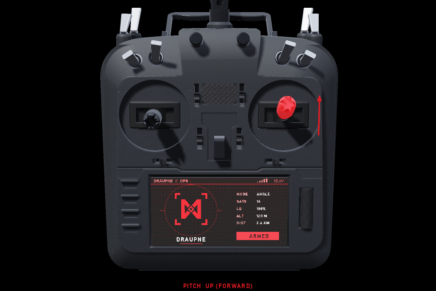
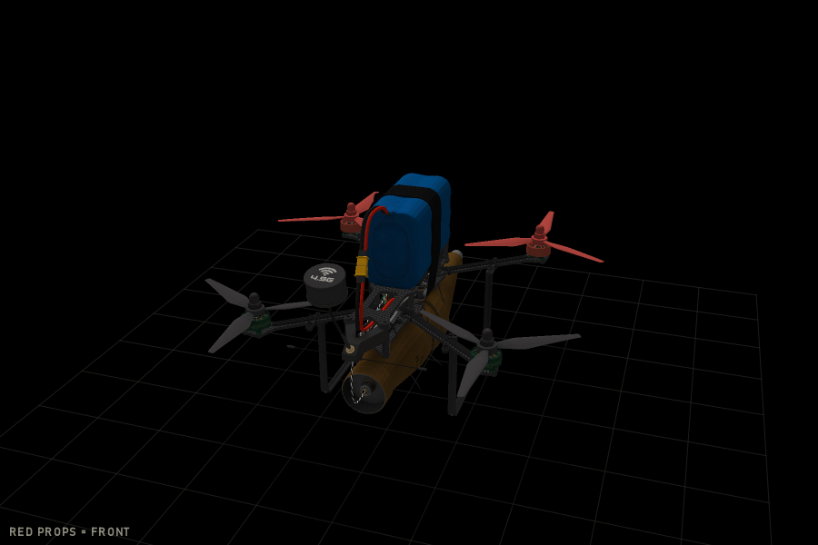
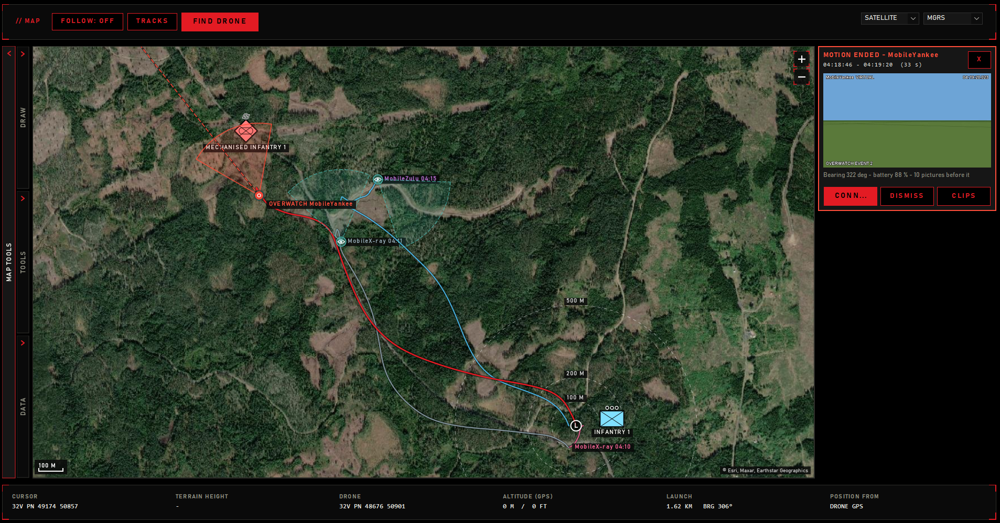

<p align="center"></p>

**Fly a Betaflight drone over the mobile network (5G or older) from a Windows PC.** Live video with OSD, a tactical map, sound, motion alerts.
Based on [DroidDrone](https://github.com/DroidDrone/DroidDrone) (called DroidDrone PC up to 1.0.15).

```
Radio --USB--> Windows PC  == 5G / mobile / Tailscale ==>  Android phone on the drone --USB (MSP)--> Betaflight
               DRAUPNE Link  <== video, telemetry, sound ==  DRAUPNE Flight app
```


## Get started

1. Download `DRAUPNE-Link-Setup-<version>.exe` from the [latest release](../../releases/latest).
2. Run it. It installs Tailscale, firewall rules and the power plan. Windows warns (not code-signed): **More info → Run anyway**.
3. Follow the setup wizard (about 15 min): PC, drone over USB, radio, phone by QR code, connect. MENU > SETUP opens it again.

**You need:** Windows 10/11, an EdgeTX radio as USB joystick, a Betaflight drone (4.4 or newer best, 4.2 flies, 2025.12 supported), an Android 8+ phone with mobile data and a USB data cable.

## Features

**Link**
- Phones and PCs get names (MobileAlpha, PCAlpha …). Pick by name, press CONNECT. No addresses.
- Sticks at 250 Hz, no queues. RC only goes out with throttle low and ARM off.
- Red frame when sticks don't reach the drone: LINK LOST, LINK STALL, NO FLIGHT CONTROLLER.
- **RC CHECK:** what Betaflight sees, and why it won't arm.
- **UPDATE PHONE APP** over the link (disarmed).

**Video and sound**
- AUTO picks SHARP (1080p) / NORMAL (720p) / ROBUST / SURVIVAL by link quality.
- Record to MKV, plus a copy with the OSD burned in. Sound included.
- Live sound from the phone's mic while disarmed. Arming mutes it. **M** mutes.
- **Motion detection** (disarmed): boxes round people, cars and lights; ignores wind in trees.
- Hardware decoding, pop-out video, F11 full screen, OSD layout editor.

**Power modes** (disarmed; arming ends them)
- **DISCONNECT** = standby: camera off, back in about 2 s.
- **DEEP SLEEP:** phone sleeps, checks in every 0/1/2/5 min (0 = always listening). WAKE brings it back.
- **OVERWATCH:** asleep, camera watching. See [Overwatch](#overwatch).

**Map** (F3 or POP OUT MAP)
- Kartverket topo, world topo, satellite, OpenStreetMap. MGRS / UTM / degrees. Works offline after **DOWNLOAD AREA**.
- Every drone on the map with its state: active, asleep, overwatch, lost, unknown. Right-click to fly, watch or copy the grid.
- Flights saved as GPX. **FIND DRONE** / **LOST DRONE** with the MGRS on the clipboard.
- **MAP TOOLS:** ruler with elevation profile, lines, rectangles, arrows, NATO symbols (MIL-STD-2525D / APP-6D), pins (add by grid), **RADIO HORIZON**, **GCS SEARCH**, **COVERAGE** (mobile network, estimate from OpenCelliD masts), overwatch **CLIPS**, KML/PNG export and import.

<table>
<tr>
<td width="50%"></td>
<td width="50%"></td>
</tr>
</table>

**Drone setup** (over USB, backup first, CONFIRM to write)
- Receiver to MSP, stick rate, cell count, GPS on one UART, compass and calibration.
- Switches: ARM AUX1, flight modes AUX2, PREARM AUX3, GPS rescue AUX4. Failsafe.
- Silent drone: beeps only on RX lost. **BEEPER** button (AUX12) beeps on demand.
- **Motor test:** reorder, spin direction, props in/out.

**Radio calibration:** move each stick and switch as the 3D radio shows. **Orientation:** the 3D drone follows the real one; Fix it sets board alignment.

<table>
<tr>
<td width="50%"></td>
<td width="50%"></td>
</tr>
</table>

**More than one PC**
- **Spectator:** a second PC watches the pilot's video and OSD (Allow spectators on the pilot PC). Never sends sticks.
- **Observation:** up to six idle drones in a grid, with sound and view cones on the map. CONNECT on a tile to fly it.
- **STANAG 4609:** MPEG-TS + MISB ST 0601 over UDP for ATAK, QGIS, VLC (MENU > LINK, Advanced).

**TOOLS > Advanced** shows rarely needed settings.

## Overwatch

A drone on the ground as a sentry. The phone sleeps with the camera watching (disarmed; arming ends it).

- Motion (people, cars, lights; not trees in wind): the drone turns red on the map, with its view and the direction.
- Alert card: live picture, **CONNECT** (wake and fly), **DISMISS**, **CLIPS**.
- The phone records the event in full quality and sends the clip after. Clips: `Documents\DRAUPNE Link\Overwatch`.
- Under 20 % battery or too hot: deep sleep by itself. About 15-25 h on 5000 mAh (estimate).



## Latency

- The mobile network (typically 40–100 ms round trip) is the biggest delay. Tailscale should go direct; setup says if relayed.
- PC side: about 3–4 ms per 720p frame from last packet to screen.
- Bitrate drops the moment ping jumps. Measure it: TOOLS > *Latency test*.
- Betaflight must handle MSP fast enough. Drone setup sets it; by hand in the CLI:
  ```
  set serial_update_rate_hz = 2000
  save
  ```

**Link gaps (Betaflight defaults):** under 0.3 s last sticks kept; 0.3–1.5 s sticks centred, throttle min; over 1.5 s failsafe. For poor coverage consider `rxfail 3 h` and GPS Rescue. Bench-test first.

## Troubleshooting

| Problem | Fix |
|---|---|
| Phone not in the PHONE list | Open DRAUPNE Flight, check Tailscale and mobile data. Name map > *Ask again* |
| FC disconnected | USB-A data cable, OTG on, tap Allow. Tick *Always open* to stop the prompt |
| RXLOSS / NO FLIGHT CONTROLLER | Run Drone setup (`serial_update_rate_hz`). Check the cable. The link log shows the cause |
| Grey or green bands | Weak uplink. AUTO switches to ROBUST; or choose ROBUST |
| ARMING BLOCKED: ANGLE | Level the drone, calibrate the accelerometer |
| ARMING BLOCKED: NOPREARM | Flip PREARM (AUX3) before ARM |
| ARMING BLOCKED: MSP | Power-cycle the FC |
| Relayed path | Wait a minute, *Check again*. OSD shows RELAY |
| Map blank in the field | DOWNLOAD AREA before leaving |
| OVERWATCH stops | Set DRAUPNE Flight to *unrestricted* in the phone's battery settings |
| Drone leans when landed | Sticks not 1500 at rest: check trims, CALIBRATE |

**Files:** settings `%APPDATA%\DraupneLink\draupne-link.properties`; logs `%APPDATA%\DraupneLink\logs` (link CSV per connection, app log); tracks, graphics, exports and clips in `Documents\DRAUPNE Link`; videos in `Videos\DRAUPNE Link`.

**Updates:** UPDATE in the MENU bar (PC), *Update available* on the phone. Never while connected to the drone.

## The phone app

**DRAUPNE Flight** (2.3.0-pc.39) is DroidDrone Flight 2.3.0 with: names, async USB writes (no RXLOSS), any FC USB chip, video tuned for weak coverage, sound, motion detection, standby / deep sleep / overwatch, phone GPS, touch lock, self-update. Source in [`flight-app/`](flight-app). Every release includes the APK.

## Testing without a drone

The **virtual fleet** plays several drones on this PC: real protocol, Betaflight-like flight, link failures, walkers and cars for motion detection. Start it with TOOLS > Virtual fleet (Advanced on), `Virtual fleet.bat` in the install folder, or `.\gradlew.bat run --args=fleet`. Virtual drones are always marked VIRTUAL.

## For developers

State, rules and release steps: [docs/HANDOFF.md](docs/HANDOFF.md). Also [PROTOCOL](docs/PROTOCOL.md), [CHANGELOG](docs/CHANGELOG.md), [ROADMAP](docs/ROADMAP.md).

```powershell
git clone --recurse-submodules https://github.com/MelonNO/draupne-link
cd draupne-link
.\gradlew.bat test               # 700+ tests
.\gradlew.bat installDist        # build\install\draupne-link\bin\draupne-link.bat
.\gradlew.bat packageInstaller   # installer, needs WiX Toolset 3
```
Needs JDK 21. Release: set `version` in `build.gradle`, update RELEASE_NOTES and CHANGELOG, push tag `v<version>`.

## License

GPL-3.0, as DroidDrone. Third-party: [THIRD-PARTY.md](THIRD-PARTY.md).
