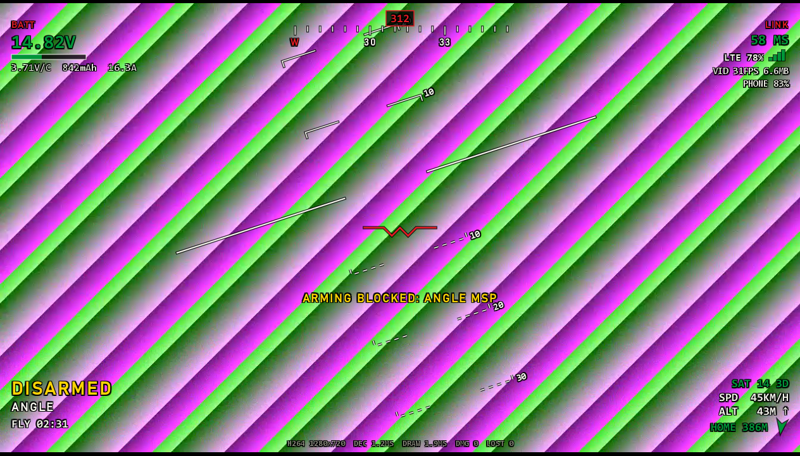
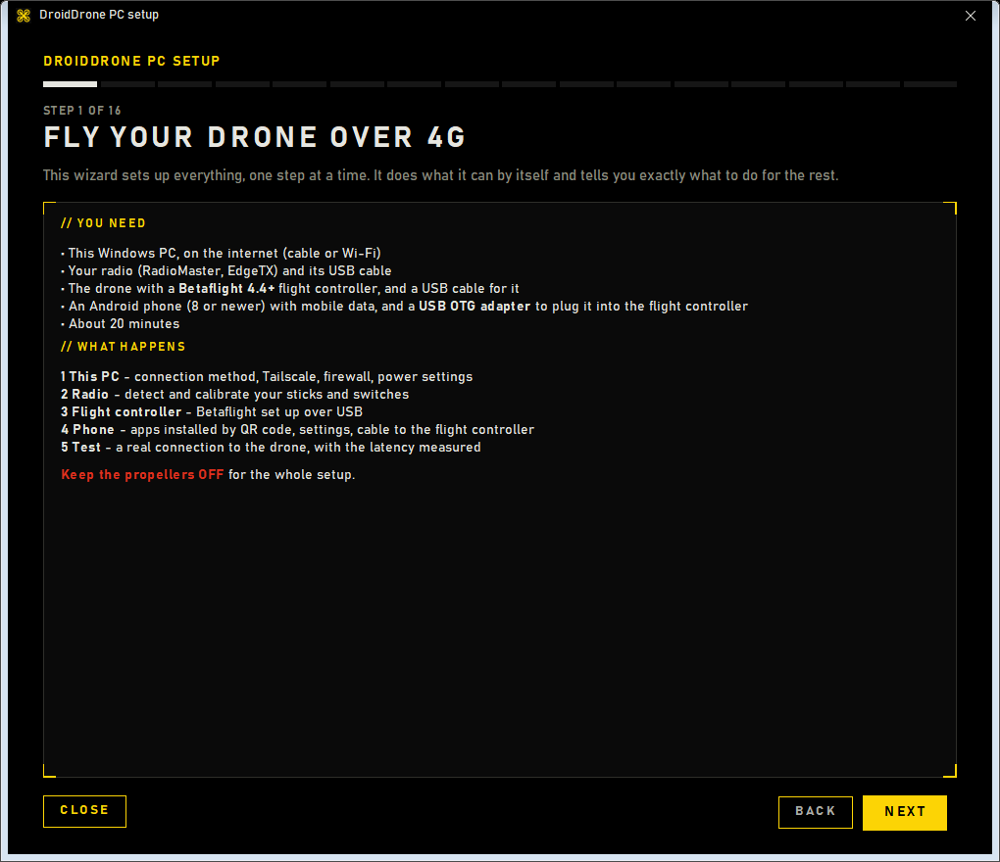
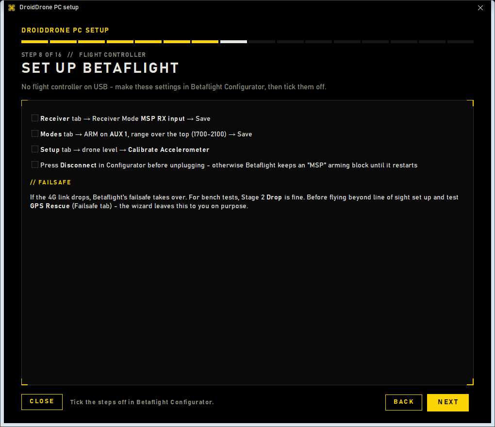
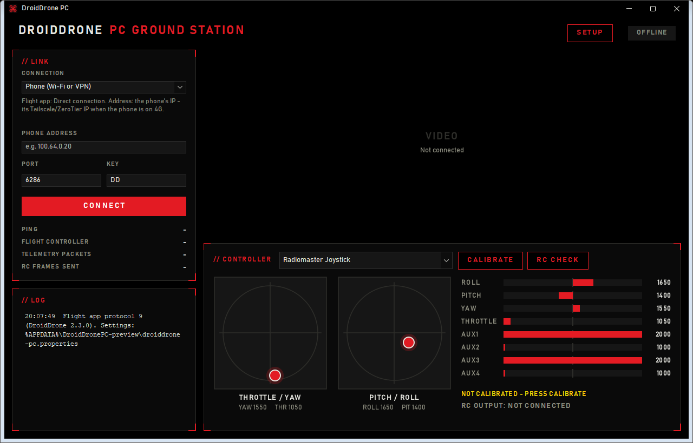

# DroidDrone PC

**Fly your Betaflight drone over 4G from a Windows PC.**
Your radio plugs into the PC; an Android phone on the drone carries the sticks, the live video and the telemetry over the mobile network.



## Get started in 3 steps

1. **Download** `DroidDrone-PC-Setup-<version>.exe` from the [latest release](../../releases/latest).
2. **Run it** and click through the installer (Next → Install → Finish). Approve the Windows prompt once: the installer then also sets up this PC by itself (**Tailscale**, firewall rules, High performance power plan) and puts **DroidDrone PC** on the desktop and in the Start menu.
   Windows may say *"Windows protected your PC"*, because the installer isn't code-signed. Click **More info → Run anyway**.
3. **DroidDrone PC starts by itself** when you press Finish (untick *Launch DroidDrone PC* to skip that). **Follow the setup wizard**: it opens on the very first start, skips whatever is already done, and takes about 15 minutes. Later, **SETUP** opens it again (*First-time setup*) or each part on its own: PC, phone or drone.

## What you need

- A Windows 10/11 PC on the internet (cable or Wi-Fi)
- A radio that works as a USB joystick (RadioMaster or any EdgeTX radio)
- A drone with a **Betaflight** flight controller, plus a USB cable for it ([which version?](#which-betaflight-version))
- An Android phone (8 or newer, 11+ recommended) with mobile data, and a **USB OTG adapter** to plug it into the flight controller

### Which Betaflight version?

Betaflight 4.4 is **not required**, only recommended:

| Betaflight | Result |
|---|---|
| **4.4, 4.5 or newer** | Best. The phone's Flight app is made for these versions, so everything works |
| **4.2 or 4.3** | Flies. The Flight app shows the version in **yellow** as a warning but still sends your sticks. RC CHECK may name some arming blocks wrongly |
| **Older than 4.2** | Not recommended: it lacks the stick delay setting (`serial_update_rate_hz`, see [Latency](#latency)), so stick updates queue up in the flight controller. Update with Betaflight Configurator's *Firmware Flasher* tab |

## The setup wizard does the work

| | The wizard does this for you | You do this, guided step by step |
|---|---|---|
| **This PC** | The **installer** installs **Tailscale** (private network between PC and phone), adds the firewall rules and switches to the High performance power plan. The wizard opens Tailscale's sign-in page and skips every step that is already done | Sign in to Tailscale |
| **Radio** | Detects it, then calibrates every stick and switch by having you move them ([like a flight sim](docs/images/setup-radio.png)) | Plug it in and pick *USB Joystick (HID)* on the radio |
| **Drone** | Over USB, with nothing to click: sets the receiver to **MSP** and the **stick delay setting**. Nothing else on the drone is touched | Plug it in. No USB cable? The page shows the same two settings for Betaflight Configurator |
| **Phone** | Downloads [this project's DroidDrone Flight](#the-phone-app), checks it, and serves it to your phone by **QR code**. Spots the phone joining Tailscale and saves its address | Scan two QR codes, set four phone settings from a short list |
| **Connect** | Shows what to type into the Flight app and holds the link open: it turns green the moment you tap CONNECT on the phone, then measures the path (direct or relayed) and the round-trip time and gives you a verdict | Type in the values, tap CONNECT, plug the phone into the flight controller |

<p>


</p>

## Flying



- Press **CONNECT**. The status turns **LINK READY** and the phone's camera appears with the **OSD**: horizon and pitch ladder, heading tape with home marker, battery (voltage per cell, big, with the cell count), 4G signal and ping, GPS, timer, flight modes and warnings.
- RC is only sent once the throttle has been seen at the bottom (**RC OUTPUT: LIVE**).
- A **red frame** round the picture means your sticks aren't reaching the drone: **LINK LOST** (PC to phone) or **NO FLIGHT CONTROLLER** (the phone lost its USB link to the flight controller; the battery and GPS values turn grey because they're frozen).
- **POP OUT VIDEO** puts the picture (with the OSD) in its own window, e.g. on a second screen; close it or press **VIDEO BACK** to put it back.
- **Double-click** the video for a full-window picture. **F11** puts the video in true full screen, which can save up to one screen refresh of delay. **F2** turns the OSD on or off. Camera mounted upside down? **SETTINGS** → *Camera mounted upside down* turns the picture; the OSD stays the right way up, and the setting is remembered.
- **F3** runs a **latency test**: point the drone's camera at the code on the screen, and the app shows the real camera-to-screen delay.
- **RC CHECK** shows what Betaflight actually sees: whether the sticks arrive, throttle low, the arm switch, active modes, and every reason it refuses to arm, with the fix for each.

## Latency

Every part is built for the least delay:
- **Sticks:** read and sent 250 times a second in a single step, with no extra queues.
- **Steady timing:** the app holds Windows' 1 ms timer, opts out of power throttling and runs at above-normal priority, so the stick rate holds even when the window is in the background. Without this, Windows can stretch the gaps between stick updates to 16 ms.
- **Video:** each frame is decoded the moment its last packet arrives, and only the newest picture is drawn. The PC side takes about 3–4 ms per 720p frame from the last packet to the screen; the stats line shows the live numbers.
- **Video bitrate:** lowered as soon as the ping climbs above its usual level, before frames get lost. Mobile networks queue up a too-high bitrate, and queueing is delay.
- **Measure it:** **F3** shows the whole camera-to-screen delay. Try it in a window and in **F11** full screen.
- **Connection:** Tailscale normally finds a **direct** path. The setup's *Connect the Flight app* step tells you if it doesn't.

The 4G network itself (typically 40–100 ms round trip) is the biggest delay. A wired PC helps a little.

**Betaflight setting that matters:** Betaflight handles one MSP message per serial cycle, and that cycle runs only 100 times a second by default. Stick updates plus the OSD's telemetry requests are more than that, so stick updates queue up in the flight controller. SETUP → *Drone setup* sets it over USB by itself (1000 on F411 boards). Without USB, type this once in Betaflight Configurator's **CLI** tab (Betaflight 4.2 or newer):
```
set serial_update_rate_hz = 2000
save
```

## Troubleshooting

| What you see | What it means / what to do |
|---|---|
| Phone app: **FC disconnected** | Tap **Connect** in the Flight app first. Then use a USB-A cable plus an OTG adapter (many flight controllers ignore USB-C to USB-C), check the phone's **OTG** setting, and tap **Allow** on the USB pop-up |
| The phone asks for **USB permission** every time the flight controller is plugged in | In that Android dialog, tick **Always open DroidDrone Flight when … is connected**, then OK. No tick box? You have the original Flight app: install this project's build (see [The phone app](#the-phone-app)). Android then lets the Flight app reconnect by itself, without asking, e.g. after a loose cable drops out. Still: a cable that drops out means your sticks don't reach the drone - fix it before flying |
| **RXLOSS** / **RC SIGNAL GAP** flickers, but nothing happens | The sticks paused for 0.1-0.3 s on their way to Betaflight. Betaflight then flags RXLOSS but keeps your last sticks; it shows the flag for 0.5 s more. Only a pause over 0.3 s matters in the air (sticks centred, throttle to minimum), and over 1.5 s it fails safe and disarms. The [link log](#troubleshooting) shows where the pauses come from: the 4G link (ping and telemetry gaps jump), or the flight controller (Betaflight's `serial_update_rate_hz` left at 100 can't keep up - run SETUP → *Drone setup*) |
| **NO FLIGHT CONTROLLER** comes and goes while the link is good | The phone gets nothing from the flight controller: check the OTG cable, and run SETUP → *Drone setup* (a `serial_update_rate_hz` left at 100 also causes it) |
| OSD says **ARMING BLOCKED: ANGLE** | The drone isn't level, or the accelerometer isn't calibrated. Calibrate it in Betaflight Configurator's **Setup** tab, drone level |
| Flight app shows the Betaflight version in **yellow** | Betaflight is older than 4.4. It still flies; update when convenient ([which version?](#which-betaflight-version)) |
| Betaflight ignores the **arm switch** | DroidDrone sends your arm switch on AUX1. In Betaflight Configurator's **Modes** tab, put ARM on AUX 1. **RC CHECK** shows what Betaflight sees |
| OSD says **ARMING BLOCKED: MSP** | Betaflight Configurator disabled arming and was unplugged without *Disconnect*. Power-cycle the flight controller. SETUP → *Drone setup* also clears it |
| **Video is black** | It's what the camera sees: is the lens covered, or is it dark? Point it at something bright. To use another lens, set `cameraId` in the settings (often `2` or `3` is the wide-angle) |
| Setup says the path is **relayed** | Tailscale couldn't go direct through your mobile network, which adds latency. Press *Check again* after a minute. If it stays relayed, choose *Host the relay on this PC* in SETUP → *PC setup* |
| Channels look wrong | **CALIBRATE**, then **RC CHECK** |

Settings live in `%APPDATA%\DroidDronePC\droiddrone-pc.properties`.

**Link log:** every connection writes a timeline to `%APPDATA%\DroidDronePC\logs\link-<date>-<time>.csv`, 10 rows a second: ping, stick frames sent and the longest gap between them, telemetry packets and the longest gap, the flight controller's last data, RXLOSS / FAILSAFE as Betaflight reports them, radio present, plus every log message. It shows which part of the chain a failsafe came from. The newest 20 are kept.

## How it works

```
Radio --USB--> Windows PC  ==== 4G / Tailscale ====>  Android phone on the drone --USB OTG (MSP)--> Betaflight
               DroidDrone PC  <== video + telemetry ==  DroidDrone Flight app
```

DroidDrone PC replaces [DroidDrone](https://github.com/DroidDrone/DroidDrone)'s *Control* phone app. It speaks the protocol of **DroidDrone Flight 2.3.0**, and compiles upstream's own protocol code from a pinned submodule, so it can't drift from the original.

### The phone app

The setup installs **DroidDrone Flight 2.3.0-pc.1**: upstream's Flight 2.3.0 with two changes, source in [`flight-app/`](flight-app):
- **Every flight controller:** its USB list covers any flight controller with native USB (STM32, AT32, APM32, GD32, RP2040; Betaflight, INAV, ArduPilot, PX4) and every USB-serial bridge chip it can drive (CH340/CH341, CP210x, FTDI, PL2303). Android can then remember the USB permission, and the phone reconnects to the flight controller without asking. Upstream only lists a few IDs, so AT32 boards, for example, needed a tap after every reconnect.
- **The PC app's look:** black and red, status at a glance (OFFLINE / WAITING / LINK READY).

The protocol is unchanged, so the original Flight 2.3.0 also still works. This build is signed with a different key: uninstall the original before installing it. Every DroidDrone PC release includes it as `DroidDrone-Flight-<version>.apk`, the exact build that version installs.

## For developers

```powershell
git clone --recurse-submodules https://github.com/<owner>/droiddrone-pc
cd droiddrone-pc
.\gradlew.bat test               # 69 tests: protocol, video decode, telemetry, calibration, Betaflight CLI, setup helpers
.\gradlew.bat installDist        # build\install\droiddrone-pc\bin\droiddrone-pc.bat
.\gradlew.bat releaseZip         # portable zip (app + Java runtime)
.\gradlew.bat packageInstaller   # installer, needs WiX Toolset 3
```
Needs JDK 21. To release, set `version` in `build.gradle`, then push a tag `v<version>`. GitHub Actions builds and publishes the installer and the zip, and attaches the phone app pinned in `ApkShare.java` (see [`flight-app/`](flight-app)).

| Package | What's in it |
|---|---|
| `de.droiddrone.pc` | Link (`ControlLink`), connection modes, joystick, calibration, RC mapping, telemetry (`FcTelemetry`) |
| `de.droiddrone.pc.video` | Frame reassembly, FFmpeg decoder, bitrate control, low-latency pipeline |
| `de.droiddrone.pc.setup` | Tailscale, firewall, power plan, shortcuts, Betaflight over USB (CLI), Flight app download/serving |
| `de.droiddrone.pc.gui` | Main window, OSD, setup wizard, calibration, RC check |

More: [protocol notes](docs/PROTOCOL.md) and [roadmap](docs/ROADMAP.md).

## License

GPL-3.0, the same as DroidDrone, whose code this build includes. Third-party components and their licenses are listed in [THIRD-PARTY.md](THIRD-PARTY.md).
