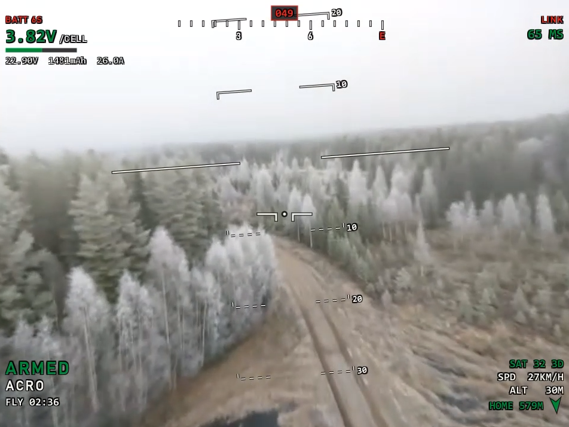
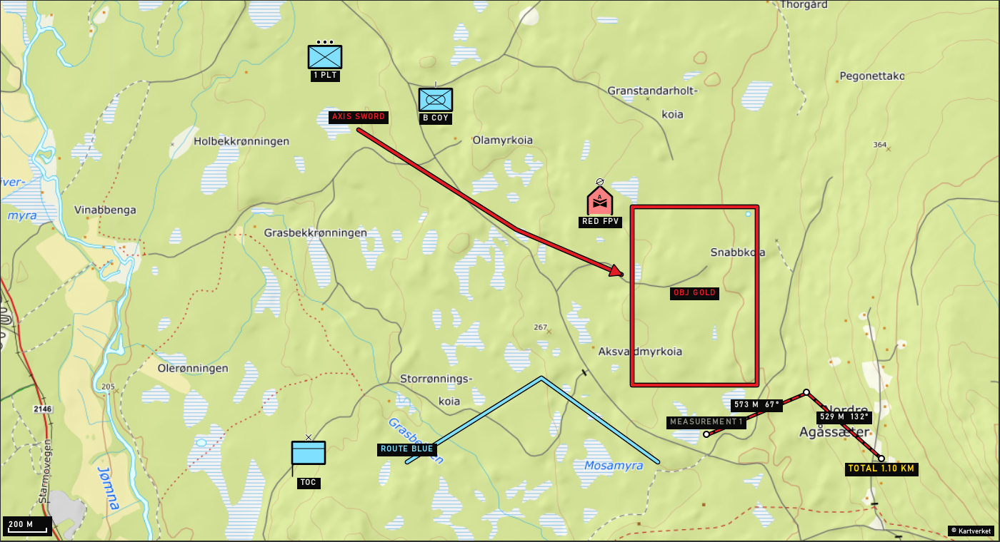
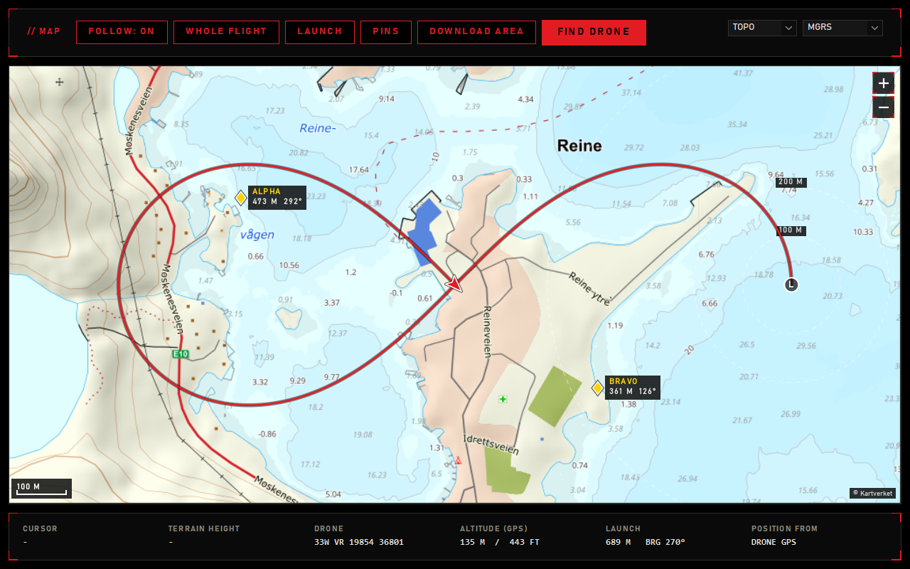
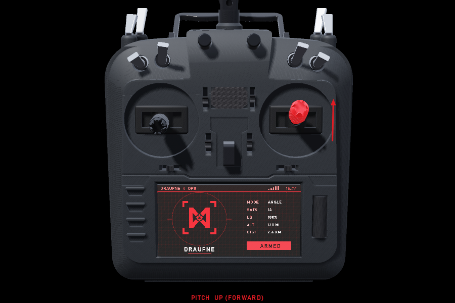
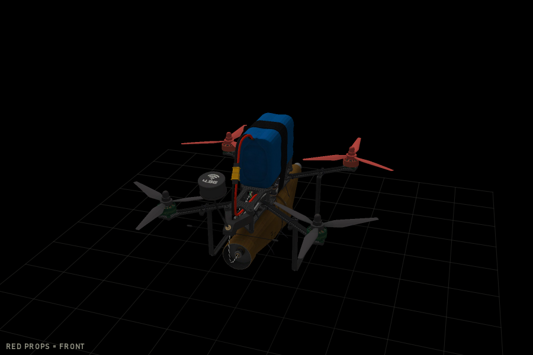
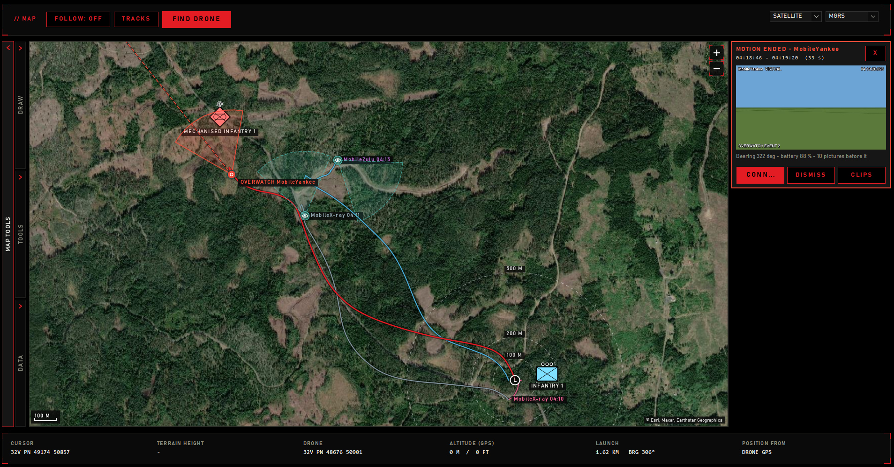

<p align="center"></p>

**Fly a Betaflight drone over the mobile network (5G or older) from a Windows PC.** Live video with OSD, a tactical map, sound, motion alerts.
Based on [DroidDrone](https://github.com/DroidDrone/DroidDrone) (called DroidDrone PC up to 1.0.15).

```
Radio --USB--> Windows PC  == 5G / mobile / Tailscale ==>  Android phone on the drone --USB (MSP)--> Betaflight
               DRAUPNE Link  <== video, telemetry, sound ==  DRAUPNE Flight app
```



## Get started

1. Download `DRAUPNE-Link-Setup-<version>.exe` from the [latest release](../../releases/latest).
2. Run it. It installs Tailscale, firewall rules and the power plan. Windows warns (not code-signed): **More info → Run anyway**.
3. Follow the setup wizard (about 15 min): PC, drone over USB, radio, phone by QR code, connect. MENU > SETUP opens it again.

**You need:** Windows 10/11, an EdgeTX radio as USB joystick, a Betaflight drone (4.4 or newer best, 4.2 flies, 2025.12 supported), an Android 8+ phone with mobile data and a USB data cable.

## Features

**Link**
- Phones and PCs get names (MobileAlpha, PCAlpha …). Pick by name, press **PILOT UAV**. No addresses.
- Sticks at 250 Hz, no queues. RC only goes out with throttle low and ARM off.
- Red frame when sticks don't reach the drone: LINK LOST, LINK STALL, NO FLIGHT CONTROLLER.
- **RC CHECK** (TOOLS): what Betaflight sees, and why it won't arm.
- **UPDATE PHONE APP** over the link (disarmed).

**Video and sound**
- AUTO picks SHARP (1080p) / NORMAL (720p) / ROBUST / SURVIVAL by link quality.
- Record to MKV, plus a copy with the OSD burned in. Sound included.
- Live sound from the phone's mic while disarmed. Arming mutes it. **M** mutes.
- **Motion detection** (disarmed): boxes round people, cars and lights; ignores wind in trees.
- Hardware decoding, pop-out video, F11 full screen, OSD layout editor.

**Power modes** (disarmed; arming ends them)
- **STANDBY MODE** (once the link is up): camera off, back in about 2 s. Until then the button is **STOP**.
- **DEEP SLEEP:** phone sleeps, checks in every 0/1/2/5 min (0 = always listening). PILOT UAV brings it back at its next check-in.
- Mode changes on a sleeping phone are queued and sent at its next check-in, without connecting.
- **OVERWATCH:** asleep, camera watching. See [Overwatch](#overwatch).

**Map** (F3 or POP OUT MAP)
- Kartverket topo, world topo, satellite, OpenStreetMap. MGRS / UTM / degrees. Works offline after **DOWNLOAD AREA**.
- Every drone on the map with its state: active, asleep, overwatch, lost, unknown. Right-click to fly, watch or copy the grid.
- **PREVIOUS FLIGHTS:** video, track and telemetry on one timeline, link quality graph, export, delete.
- **FIND DRONE** / **LOST DRONE** with the MGRS on the clipboard. LOST DRONE marks the drone OUT OF ACTION (any drone can be marked by right-click: it stays until cleared, and its last known grid is kept).
- **MAP TOOLS:** ruler with elevation profile, lines, rectangles, arrows, NATO symbols (MIL-STD-2525D / APP-6D), pins list, **RADIO HORIZON**, **GCS SEARCH**, **COVERAGE** (mobile network, estimate from OpenCelliD masts), overwatch **CLIPS**, KML/PNG export and import.

<table>
<tr>
<td width="50%"></td>
<td width="50%"></td>
</tr>
</table>

- **FLEET** (map's right edge): every phone in one row, mode, batteries, last heard, next check-in. Queue modes without connecting. 10 phones without scrolling.

**Drone setup** (over USB, backup first, CONFIRM to write). **SETUP > Set up a new drone** for one more drone and phone.
- Receiver to MSP, stick rate, cell count, GPS on one UART, compass and calibration. Failsafe GPS rescue by default.
- Switches: ARM AUX1, flight modes AUX2, PREARM AUX3, GPS rescue AUX4. Failsafe.
- Silent drone: beeps only on RX lost. **BEEPER** button (AUX12) beeps on demand.
- **Motor test:** reorder, spin direction, props in/out.

**Radio calibration:** move each stick and switch as the 3D radio shows. **Orientation:** the 3D drone follows the real one; Fix it sets board alignment.

<table>
<tr>
<td width="50%"></td>
<td width="50%"></td>
</tr>
</table>

**More than one PC**
- **Spectator:** a second PC watches the pilot's video and OSD (Allow spectators on the pilot PC). Never sends sticks.
- **Observation:** up to six idle drones in a grid, with sound and view cones on the map. CONNECT on a tile to fly it.
- **STANAG 4609:** one stream per drone, a port each (MPEG-TS + MISB ST 0601 over UDP) for ATAK, QGIS, VLC. Video with OSD while piloted or observed; an overwatch alert's picture, then its clip; else the drone's mode. Overwatch sectors in the metadata. Made on the PC: nothing extra from the phones (MENU > LINK, Advanced).

**TOOLS > Advanced** shows rarely needed settings, and **RESET SETUP** (settings only, like a fresh install).

**Tour:** a guided walk through every part, ending with an overwatch alert you fly to. **SETUP > Overwatch demo** (Advanced) jumps to that part.

## Overwatch

A drone on the ground as a sentry. The phone sleeps with the camera watching (disarmed; arming ends it).

- Motion (people, cars, lights; not trees in wind): the drone turns red on the map, with its view and the direction.
- Alert card: live picture, **CONNECT** (wake and fly), **DISMISS**, **CLIPS**.
- The phone records the event in full quality and sends the clip after. Clips: `Documents\DRAUPNE Link\Overwatch`.
- Under 20 % battery or too hot: deep sleep by itself. About 15-25 h on 5000 mAh (estimate).



## ArduPilot and the fleet (the `fleet` branch: not released, not flown)

ArduPilot Copter 4.6 or newer (1 MB flash and up) beside Betaflight. Spec: [docs/fleet/PRD.md](docs/fleet/PRD.md).
Nothing in this chapter has flown yet. Try each part on the bench, props off, before a field.

**ArduPilot drones**
- The phone tells ArduPilot from Betaflight by itself. FLEET and the drone's card say **ARDU** or **BTFL**.
- Change the flight mode with the radio's mode switch. A 3-position switch gives STABILIZE, ALT HOLD and LOITER.
- The buttons on the video are the backup: **LOI** (hold), **RTL** (home), **LND** (land), **GO** (start or pause a
  route). The lit one is the mode it is in. A red one: the drone said no. The mode switch wins again when you move it.
- RC CHECK shows ArduPilot's own reason it won't arm.
- Link lost: it holds (LOITER) after 1 s and flies home after 20 s. Without GPS it holds its height and waits.
- **SETUP > ArduPilot drone setup** (USB, battery off): a backup first, then the settings, calibrations, motors and an
  arm check. It puts ARM and the mode switch on the same switches as your Betaflight drones.
- The battery never sends it home: a warning, then LAND at 3 %. Watch **LEFT m:ss** and **HOME NOW** on the OSD.

**Routes**
- **MAP TOOLS > ROUTE**: click points, drag to move, right-click to insert, delete or give a point its own height.
  Right-click the map: *Fly to here*.
- It flies a set height above the ground (60 m unless you change it): above bare ground, not trees or buildings.
- **UPLOAD** sends it and checks every point on the drone. **GO** flies it. At the end it holds and calls you.
- **MASTS** shows power lines and masts near the route (OpenStreetMap, not complete). **FENCE** makes the airspace
  areas on the map the drone's own fence: it stops at the edge.

**Fleet dispatch**
- Right-click landed drones: **SAFE TO AUTOLAUNCH: mark**. Then right-click the map: **DISPATCH ... here**.
- First a preview: each drone's time out, its wait for you, and the way back. **RUNS LOW** means its battery won't do it.
- Each drone gets its own spot, height layer and route. They take off a few seconds apart and wait at their spots
  (**YOUR TURN**). Right-click one: **TAKE CONTROL** gives you its sticks, **VIEW** shows its camera.

**Follow group and DISCARD LEAD**
- Fly the lead. Right-click others: **FOLLOW GROUP: add**, then **start**. They keep a block near the lead and don't
  move while you circle near it. They catch up when you fly away.
- Floor: right-click a drone, **Floor +5 m / -5 m** (40 m to start, never under 10 m; over 120 m you get a warning).
- **DISCARD LEAD** (radio switch, AUX5): the bottom drone with the least battery drops out under the group and becomes
  the lead. You get its sticks and video. The old lead holds where it is.
- Lead silent 30 s: the same happens by itself. Lead landed: the group holds and the OSD says **LEAD DOWN**.
- The words on the map and in FLEET: IN GROUP, CATCHING UP, HOLDING, LOST, GNSS LOST, LANDING.

**Safe autolaunch**
- Mark only a drone on clear ground with nothing above it: it climbs straight up to the floor. The app asks you first.
- **CALL RESERVE** (radio switch, AUX6): each flip calls one more marked drone, the one that would get there first.
  The OSD lists them: **+2 RESERVES: R1 1:20 ...**. None left: **NO RESERVE**.
- Before the motors start its phone checks it is level, where it was marked, not moved and healthy, then beeps 2 s.
- The climb is watched on the phone: tipping, a hit, no climb or drifting stops the motors at once (**LAUNCH FAILED**)
  and the next reserve is called. A small view of its camera shows in your corner until it is above the floor.
- Only a marked drone ever starts by itself, and only when you call. One moved or tipped since it was marked won't
  start (**MOVED**, **TIPPED**). One OUT OF ACTION is never called.

**Airspace: how drones keep apart**
- **Layers:** every drone has a height of its own, 10 m apart. Drones move sideways only in their own layer and change
  height only straight up or down where nothing else is.
- **The hollow cube:** the followers fly as a block, 8 to a layer round an empty middle, 20 m apart, lowest battery at
  the bottom. Nothing ever flies through the middle, so every drone can step straight out.
- **Transit areas:** four shafts, one beside each side of the block. Drones go up or down only there, one at a time.
- **Keep-out:** a red zone round the block. You (the lead) stay outside it; if you come close the whole block moves
  away. **TRAFFIC 14 M NE +3 M** on the OSD: another drone is close.
- **Link lost (a follower):** it holds 2 minutes, then flies out of the block along its own lane, climbs and goes home.
  It carries this plan with it, so it works without the PC.
- **GPS lost:** a drone alone holds its height and waits. In the block the others move away from it; if several lose
  GPS, they land one column at a time, bottom first.
- **PREVIOUS FLIGHTS** shows each flight's closest approach to another DRAUPNE drone: **CLOSEST** (hover for who).
- Spectator and observation PCs see the groups, routes, states and TRAFFIC too, but get none of these controls.

## Latency

- The mobile network (typically 40–100 ms round trip) is the biggest delay. Tailscale should go direct; setup says if relayed.
- PC side: about 3–4 ms per 720p frame from last packet to screen.
- Bitrate drops the moment ping jumps. Measure it: TOOLS > *Latency test*.
- Betaflight must handle MSP fast enough. Drone setup sets it; by hand in the CLI:
  ```
  set serial_update_rate_hz = 2000
  save
  ```

**Link gaps (Betaflight defaults):** under 0.3 s last sticks kept; 0.3–1.5 s sticks centred, throttle min; over 1.5 s failsafe. For poor coverage consider `rxfail 3 h` and GPS Rescue. Bench-test first.

## Troubleshooting

| Problem | Fix |
|---|---|
| Phone not in the PHONE list | Open DRAUPNE Flight, check Tailscale and mobile data. Name map > *Ask again* |
| FC disconnected | USB-A data cable, OTG on, tap Allow. Tick *Always open* to stop the prompt |
| RXLOSS / NO FLIGHT CONTROLLER | Run Drone setup (`serial_update_rate_hz`). Check the cable. The link log shows the cause |
| Grey or green bands | Weak uplink. AUTO switches to ROBUST; or choose ROBUST |
| ARMING BLOCKED: ANGLE | Level the drone, calibrate the accelerometer |
| ARMING BLOCKED: NOPREARM | Flip PREARM (AUX3) before ARM |
| ARMING BLOCKED: MSP | Power-cycle the FC |
| Relayed path | Wait a minute, *Check again*. OSD shows RELAY |
| Map blank in the field | DOWNLOAD AREA before leaving |
| OVERWATCH stops | Set DRAUPNE Flight to *unrestricted* in the phone's battery settings |
| Drone leans when landed | Sticks not 1500 at rest: check trims, CALIBRATE |

**Files:** settings `%APPDATA%\DraupneLink\draupne-link.properties`; logs `%APPDATA%\DraupneLink\logs` (link CSV per connection, app log); tracks, graphics, exports and clips in `Documents\DRAUPNE Link`; videos in `Videos\DRAUPNE Link`.

**Updates:** UPDATE in the MENU bar (PC), *Update available* on the phone. Never while connected to the drone.

## The phone app

**DRAUPNE Flight** (2.3.0-pc.52) is DroidDrone Flight 2.3.0 with: names, async USB writes (no RXLOSS), any FC USB chip, video tuned for weak coverage, sound, motion detection, standby / deep sleep / overwatch, phone GPS, touch lock, self-update. Source in [`flight-app/`](flight-app). Every release includes the APK.

## Testing without a drone

The **virtual fleet** plays several drones on this PC: real protocol, Betaflight-like flight, link failures, walkers and cars for motion detection. Start it with TOOLS > Virtual fleet (Advanced on), `Virtual fleet.bat` in the install folder, or `.\gradlew.bat run --args=fleet`. Virtual drones are always marked VIRTUAL.

The **test bench** tests the whole app on one PC - the real window with its buttons pressed, bad links, the phone app in an emulator: `.\bench.ps1 quick`, see [docs/TESTING.md](docs/TESTING.md).

## For developers

State, rules and release steps: [docs/HANDOFF.md](docs/HANDOFF.md). Also [PROTOCOL](docs/PROTOCOL.md), [CHANGELOG](docs/CHANGELOG.md), [ROADMAP](docs/ROADMAP.md).

```powershell
git clone --recurse-submodules https://github.com/MelonNO/draupne-link
cd draupne-link
.\gradlew.bat test               # 1300+ tests
.\gradlew.bat installDist        # build\install\draupne-link\bin\draupne-link.bat
.\gradlew.bat packageInstaller   # installer, needs WiX Toolset 3
```
Needs JDK 21. Release: set `version` in `build.gradle`, update RELEASE_NOTES and CHANGELOG, push tag `v<version>`.

## License

GPL-3.0, as DroidDrone. Third-party: [THIRD-PARTY.md](THIRD-PARTY.md).
