<p align="center"></p>

**Fly your Betaflight drone over 4G from a Windows PC - with a tactical map, NATO symbols and a phone that only needs a name.**
Named after Draupne (Old Norse *Draupnir*), Odin's ring. Based on [DroidDrone](https://github.com/DroidDrone/DroidDrone)
and called DroidDrone PC up to version 1.0.15.

Your radio plugs into the PC; an Android phone on the drone carries the sticks, the live video and the telemetry over the mobile network. The PC shows the picture with a full OSD, a map of where the drone is and has been, and a set of map tools for planning the flight. The map works without internet once you have saved the area, and a second PC can watch the flight.

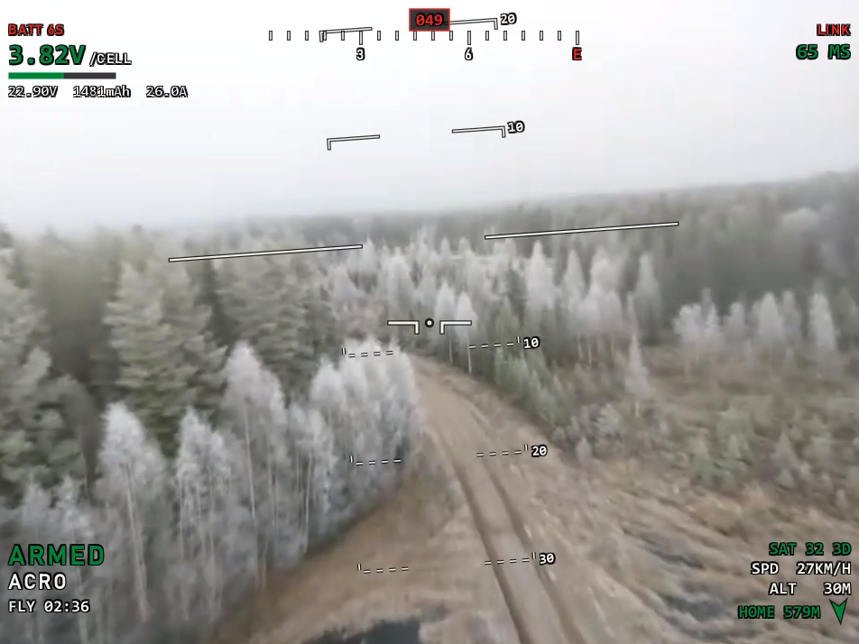

## What it looks like

<table>
<tr>
<td width="50%">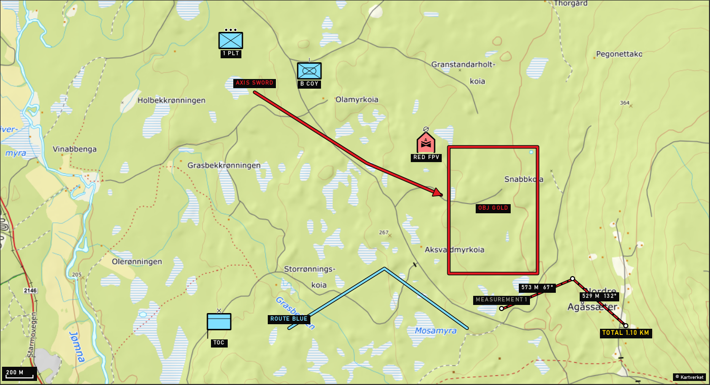<br><b>Map tools.</b> Standard unit symbols (MIL-STD-2525D / APP-6D), lines, rectangles, arrows, a ruler with an elevation profile, a radio horizon over terrain and forest, and a heat map of where to put the ground station. Export a box as a picture and KML; import KML from Google Earth or ATAK.</td>
<td width="50%">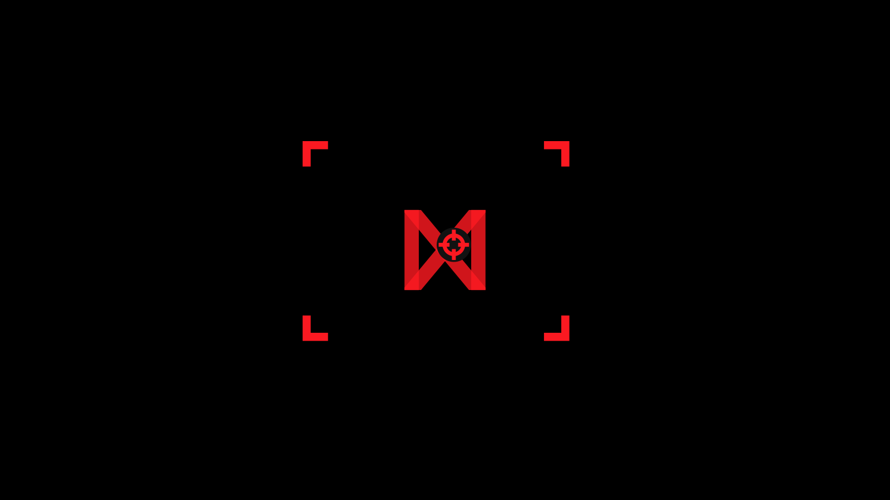<br><b>The start.</b> The mark comes apart: its brackets fly to the window's corners, its crosshair into the video, its bars become the cards. Four seconds, a click skips it.</td>
</tr>
<tr>
<td>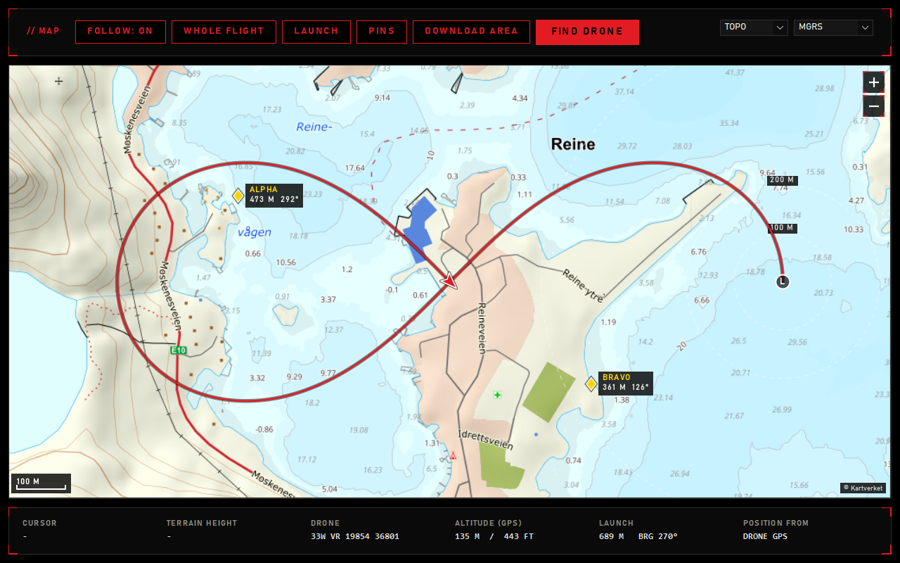<br><b>The map.</b> Kartverket topo and printed maps, a topo map of the whole world, satellite pictures or OpenStreetMap, MGRS / UTM / degrees, pins with distance and bearing, every flight saved as GPX, whole areas saved for flying offline.</td>
<td>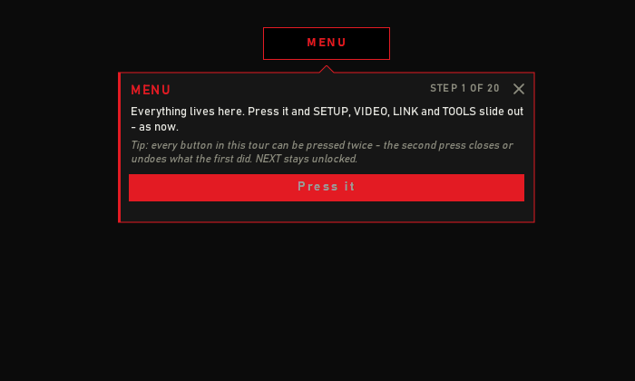<br><b>The tour.</b> After setup, a guided walk through the window, button by button. After an update, a short tour of just what is new.</td>
</tr>
</table>

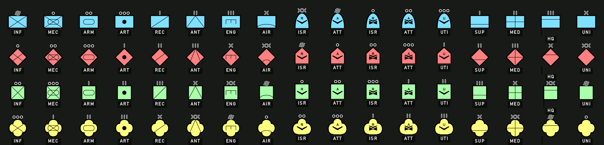

**Symbols to the standard:** infantry, mechanised infantry, armour, artillery, reconnaissance, anti-tank, engineer, air defence, mortar, rocket artillery, ISR and attack drones (fixed-wing and multirotor), recovery / maintenance, supply, medical, headquarters and a plain unit, each as friend, hostile, neutral or unknown, with echelon marks from team to division.

## Get started in 3 steps

1. **Download** `DRAUPNE-Link-Setup-<version>.exe` from the [latest release](../../releases/latest).
2. **Run it** and click through the installer (Next → Install → Finish). Approve the Windows prompt once: the installer then also sets up this PC by itself (**Tailscale**, firewall rules, High performance power plan) and puts **DRAUPNE Link** on the desktop and in the Start menu.
   Windows may say *"Windows protected your PC"*, because the installer isn't code-signed. Click **More info → Run anyway**.
3. **DRAUPNE Link starts by itself** when you press Finish (untick *Launch DRAUPNE Link* to skip that). **Follow the setup wizard**: it opens on the very first start, skips whatever is already done, and takes about 15 minutes. It ends with a short **tour** of the window (MENU > SETUP > *Tour* any time). Later, **MENU > SETUP** opens it again (*First-time setup*) or each part on its own: PC, phone or drone.

## What you need

- A Windows 10/11 PC on the internet (cable or Wi-Fi)
- A radio that works as a USB joystick (RadioMaster or any EdgeTX radio)
- A drone with a **Betaflight** flight controller, plus a USB cable for it ([which version?](#which-betaflight-version))
- An Android phone (8 or newer, 11+ recommended) with mobile data, and a **USB data cable** to plug it into the flight controller

### Which Betaflight version?

Betaflight 4.4 is **not required**, only recommended:

| Betaflight | Result |
|---|---|
| **4.4, 4.5 or newer** | Best. The phone's Flight app is made for these versions, so everything works |
| **4.2 or 4.3** | Flies. The Flight app shows the version in **yellow** as a warning but still sends your sticks. RC CHECK may name some arming blocks wrongly |
| **Older than 4.2** | Not recommended: it lacks the stick delay setting (`serial_update_rate_hz`, see [Latency](#latency)), so stick updates queue up in the flight controller. Update with Betaflight Configurator's *Firmware Flasher* tab |

## The setup wizard does the work

| | The wizard does this for you | You do this, guided step by step |
|---|---|---|
| **This PC** | The **installer** installs **Tailscale** (private network between PC and phone), adds the firewall rules and switches to the High performance power plan. The wizard opens Tailscale's sign-in page and skips every step that is already done | Sign in to Tailscale |
| **Drone** | Over USB, with nothing else to click: backs up Betaflight's settings first, then sets the receiver to **MSP**, the **stick delay setting**, the battery's **cell count** (`force_battery_cell_count`, 6 unless you change it), the **GPS** if you have one (on, on its UART - UART3 unless you change it - and the **compass** on or off, with a **compass calibration** window), your **switches** (ARM on AUX1, a 3-position flight mode switch on AUX2: acro / angle / GPS position hold, PREARM on AUX3 - a second switch that must be on before ARM arms) and the **failsafe** (leave as it is, drop, or GPS rescue, with a rescue switch on AUX4). Each can be changed or left alone; nothing else on the drone is touched, and nothing GPS is shown without a GPS. Set everything, press **CONFIRM**, and the rows turn green as Betaflight takes it | Answer the GPS question, check the cell count, plug it in, press CONFIRM. No USB cable? **By hand** shows the same settings for Betaflight Configurator |
| **Radio** | Detects it (pick one if several are plugged in), then calibrates every stick and switch by having you move them ([like a flight sim](docs/images/setup-radio.png)) - a 3D radio shows each move; the switches are named after what Drone setup put on them (ARM, flight modes, PREARM, GPS rescue) | Plug it in and pick *USB Joystick (HID)* on the radio |
| **Phone** | Downloads [this project's DRAUPNE Flight](#the-phone-app), checks it, and serves it to your phone by **QR code**. The step turns green by itself the moment the app is open on the phone and answers by name | Scan two QR codes, allow what the phone app asks for; it points out the rest in yellow |
| **Connect** | Lists the phone by its name (MobileAlpha ...) the moment DRAUPNE Flight is open on it, and holds the link open: it turns green by itself, then measures the path (direct or relayed) and the round-trip time and gives you a verdict. Can run the latency test right after setup | Pick the phone, press CONNECT, plug the phone into the flight controller |

<p>
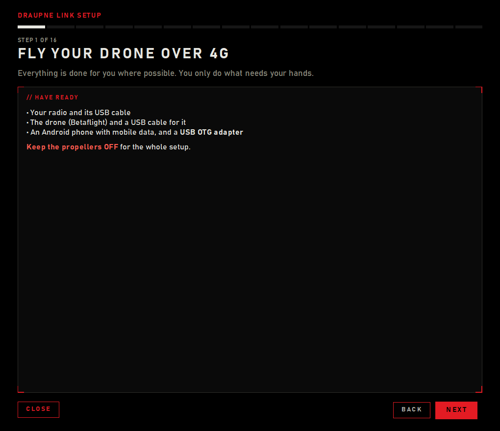
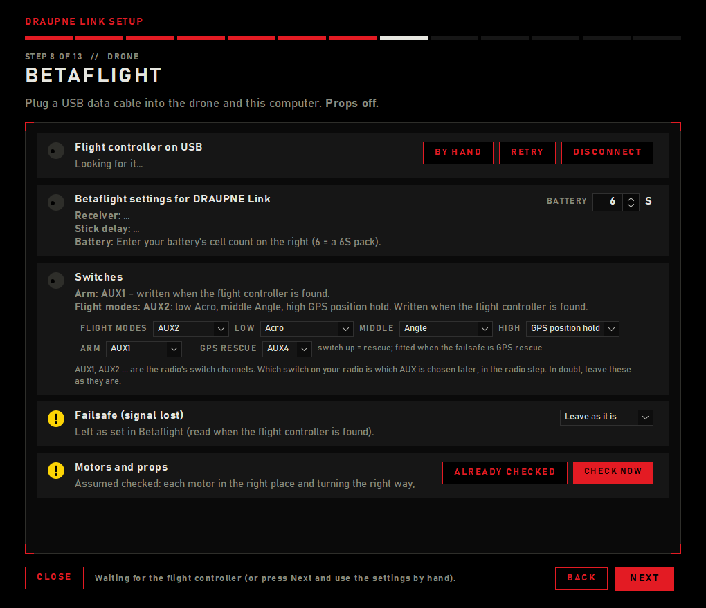
</p>

## Names, not addresses

Every phone running DRAUPNE Flight on your Tailscale network is **MobileAlpha, MobileBravo ...** and every PC running DRAUPNE Link is **PCAlpha, PCBravo ...** Nobody types an address: the PC asks every device on the network who it is, the pilot PC with the highest letter online gives each new phone the first free name, and the phone keeps it. On the LINK card you pick the phone by name and press CONNECT; a spectator picks the pilot PC the same way.

**MENU > LINK > Name map** lists every phone and PC the PC has seen: name, address, device, Tailscale machine name, when it was last seen. **RENAME** gives a phone another name (the phone is told and keeps it), **REMOVE** forgets a device, and *THIS PC IS* changes this PC's own letter. The phone shows its name on its status card; a tap there picks one by hand.

## Flying

- Press **CONNECT** (as **Pilot**; **Spectator**, next to it, only watches another PC's flight, see [below](#watching-from-a-second-pc)). The status turns **LINK READY** and the phone's camera appears with the **OSD**: horizon and pitch ladder, heading tape with home marker, battery (voltage per cell, big, with the cell count - corrected when Betaflight counted wrong), the phone's battery, 4G signal and ping, GPS, flight timer, the flight controller's core temperature, flight mode (ACRO / AIR / ANGLE / HORIZON / ACRO TRAINER / ALT HOLD / POS HOLD / GPS RESCUE / TURTLE ...) and warnings.
- RC is only sent once the throttle has been seen at the bottom and the arm switch off (**RC OUTPUT: LIVE**; until then the OSD says *RC OFF - THROTTLE DOWN* or *ARM SWITCH OFF*).
- A **red frame** round the picture means your sticks aren't reaching the drone: **LINK LOST** (PC to phone), **LINK STALL** (the phone stopped answering) or **NO FLIGHT CONTROLLER** (the phone lost its USB link to the flight controller; the battery and GPS values turn grey because they're frozen). **RADIO FROZEN?** means the radio's input hasn't changed a bit for 5 s while armed, **VIDEO FROZEN** that no new picture came for 0.7 s.
- A **minimap** sits on the LINK card under the figures, always, with **POP OUT MAP** for the whole [map](#the-map).
- **MENU** slides out everything else: **SETUP**, **VIDEO**, **LINK**, **TOOLS**, and **UPDATE** when there is one.
- **Double-click** the video for a full-window picture. **F11** puts the video in true full screen, which can save up to one screen refresh of delay. **F2** turns the OSD on or off, **F3** opens the map window.
- **RC CHECK** shows what Betaflight actually sees: whether the sticks arrive, throttle low, the arm switch, active modes, and every reason it refuses to arm, with the fix for each.
- **STANDBY and DEEP SLEEP** on the LINK card save the phone's battery before take-off. STANDBY stops the camera, slows the GPS and telemetry and dims the screen; WAKE brings the picture back in about two seconds. DEEP SLEEP drops the link, locks the phone's screen and lets it sleep; every CHECK EVERY minutes (1, 2 or 5) it listens for the PC for 20 s, says *still here* with its battery, and WAKE brings it back at its next check with nobody touching the phone. Neither works while the drone is armed, and both end by themselves when it arms.
- **LOST DRONE** appears on the LINK card when the link drops while the drone is armed: one press opens FIND DRONE with the MGRS on the clipboard.

**MENU > VIDEO**
- **Video: AUTO / SHARP / NORMAL / ROBUST / SURVIVAL.** **NORMAL** is 1280x720 at up to 4 Mbit/s. **SHARP** is 1920x1080 at up to 8 Mbit/s (the sizes and limits are in the settings file). **ROBUST** trades sharpness for a picture that holds on a weak link: a small picture (640x360, or the nearest size the phone has), at most 1 Mbit/s, key frames sent twice, and a small parity packet per group of packets from which the PC rebuilds any one lost packet, so a single lost packet no longer leaves a grey or green band. **AUTO** (the default) goes sharp after 20 s of calm at the top bitrate and back to the normal picture at the first stall; it switches to bad coverage mode by itself after 5 s at the lowest bitrate or 3 stalls within 30 s, and back after 20 s of calm; when even that can't carry it, **SURVIVAL**: 480x270 at 15 fps, up to 250 kbit/s, some picture rather than none. Every one of them can be chosen and held instead of AUTO, and a choice takes at once.
- **Camera upside down** turns the picture; the OSD stays the right way up.
- **Record video** saves every flight's video to `Videos\DRAUPNE Link`, exactly as it comes from the phone (MKV, no extra delay). A red **REC** shows on the OSD while it records. Next to it goes a copy with the OSD drawn in (`...-osd.mkv`), made on a low-priority thread of its own so the live picture never waits for it.
- **Hardware video decoding** (off by default) decodes on the GPU. Only worth trying with big pictures or a slow CPU: at 720p it's slower.
- **OSD** on or off, and **OSD layout**, which works like Betaflight's OSD tab: switch elements on or off (throttle %, current, mAh, power, RSSI, GPS coordinates, clock, stick overlays and more are there, off by default) and drag them where you want them. It shows on the live OSD at once and is remembered.
- **POP OUT VIDEO** (the button over the video) puts the picture (with the OSD) in its own window, e.g. on a second screen; close it or press *VIDEO BACK* to put it back. **FULL SCREEN** is the button next to it. **Full screen** is F11.
- **Sound:** while the drone is disarmed you hear the phone's microphone (phone app 2.3.0-pc.34 or newer; it stops the moment the drone arms). **MUTE** (the filled loudspeaker at the edge of the video) or **M** silences it at once; after 10 s muted the phone stops sending it. Remembered per phone. Recordings include it.

**MENU > LINK**
- **Warning sounds:** a short beep when the sticks stop reaching the drone (LINK LOST, LINK STALL, FAILSAFE, NO FLIGHT CONTROLLER), on by default.
- **Allow spectators:** off by default, see [below](#watching-from-a-second-pc).
- **Name map:** see [Names, not addresses](#names-not-addresses).

**MENU > TOOLS**
- **Find drone:** the drone's last known position with the coordinates to copy and map links, to go and get it after a crash. It refreshes live, falls back to the last track file after a restart, and shows a phone fix's accuracy.
- **Position from: DRONE / PHONE.** The map can follow the phone's own GPS instead of the drone's (location allowed on the phone). It stays after a crash that killed the flight controller; the other source fills in when the chosen one has nothing.
- **Tracks folder:** every flight's path as a GPX file, see [The map](#the-map).
- **Latency test:** point the drone's camera at the code on the screen, and the app shows the real camera-to-screen delay (Esc stops it). The setup guide offers it too, right after setup.
- **Motor test:** like Betaflight's Motors tab, over USB with the drone on the bench and **props off**: spin each motor and check it's where its number says and turns the way its arrow points, then fit the props so their leading edges follow the arrows. A motor in the wrong place: **Reorder motors** spins each in turn, you click where it is, and Betaflight's motor order is set to match. One turning the wrong way: **Spin direction** tells its ESC Normal or Reversed (DShot ESCs). **Props in / props out** sets Betaflight's motor direction too.
- **Orientation:** a drone in 3D moves as Betaflight sees the real one. Put it flat, lift the nose, flat again, lower the right side: Betaflight must see each move the right way round. A flight controller turned on the frame and not set in Betaflight flips the drone on takeoff; **Fix it** sets Betaflight's board alignment (a backup first) and checks again.
- The versions of DRAUPNE Link and the phone app it brings.

## The map


**POP OUT MAP** on the LINK card (or **F3**) opens the map in a window of its own, for a second screen. The map shows where the drone is and has been, over **Kartverket's** topo or printed map, **satellite** pictures, the **world topo map** (OpenTopoMap: contours and forest everywhere) or **OpenStreetMap** (AUTO and TOPO pick Kartverket in Norway and the world topo map elsewhere). FOLLOW, WHOLE FLIGHT, LAUNCH and FIND DRONE buttons; + and -, the wheel and dragging move it. Under the map: the place under the mouse and the terrain height there in metres and feet, the drone's position, altitude, distance and bearing from the launch point. Coordinates in **MGRS** (default), UTM, decimal degrees or degrees-minutes-seconds. Keys: **+ / -** zoom, **Home** the launch point, **End** the drone, **F3** closes the window.

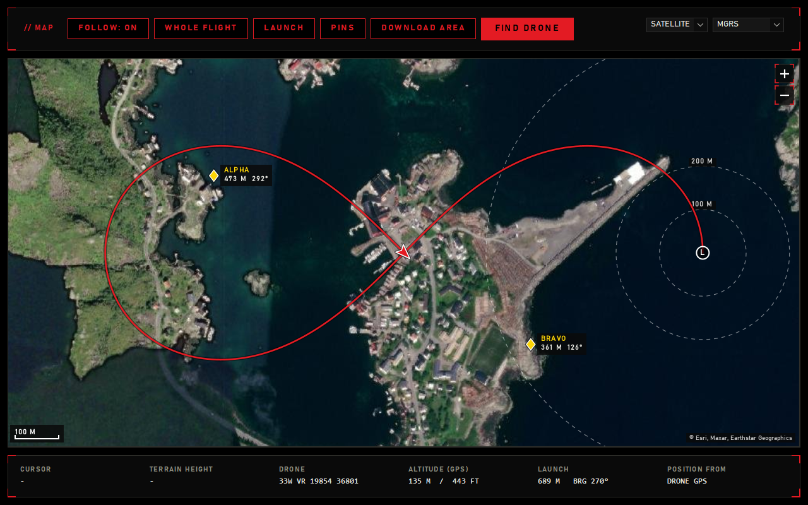

### MAP TOOLS

The tab at the map's left edge slides out three flat tabs - **DRAW**, **TOOLS** and **DATA** - and each of them slides out its own list:

- **RULER:** click point after point; each leg shows its length and bearing, the total adds up, and clicking the first point again closes the loop and gives the **area**. The terrain's **elevation profile** along the line appears under the map, with the highest and lowest point. KEEP turns a measurement into a graphic that stays; CLEAR takes it off.

  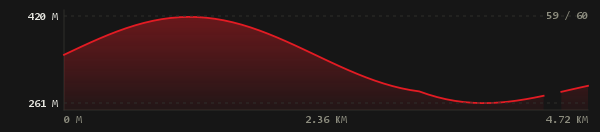

- **LINE, RECTANGLE, ARROW:** in a colour and width of your choice; a rectangle as an outline or a see-through fill. Every graphic has a name you can edit.
- **SYMBOL:** a unit symbol to **MIL-STD-2525D / APP-6D** where you click: the type, the affiliation (friend, hostile, neutral, unknown) and the echelon (team ... division). The drones are the standard's unmanned-aircraft symbols with their role letter.
- **PLACE AT:** a point of the drawing, or a symbol, at a typed position (MGRS, UTM or latitude, longitude); the map centres there.
- **Move anything** by double-clicking a point of it: it follows the mouse, a click drops it, Esc puts it back. **ERASER** removes what you click.
- **RADIO HORIZON** (TOOLS): the mast's height and the aircraft's altitude above the ground under it (it follows the terrain), the trees' height and the link's frequency; click the map to put the mast there. Blue (so it reads over a GCS SEARCH heat map) is where the aircraft can see the mast over the terrain and through the forest, **30 km at most**: a hill blocks, trees cost signal by their depth in the line and the frequency (FITU-R; past 20 dB, out of sight: about 9 m of trees at 5.8 GHz, 37 m at 2.4 GHz, 200 m at 800 MHz).
- **GCS SEARCH** (TOOLS): where to put the ground station. The same fields; drag a box round the area you want good reception in, and a heat map 30 km round it shows how much of that area an antenna would see from each place - green all of it, red none - with the best place ringed, every 100 m; it too stays until crossed out. The fields of both tools slide out under their button. The forest is read off the map's own colours close in (Kartverket's topo at zoom 15 in Norway, OpenStreetMap at zoom 13 elsewhere); the first time an area takes a while to load (it draws as the forest map comes in, nearest first), after that it is instant. One mast at a time; it stays on the map until the cross on its label takes it off.
- **PINS:** right-click on the map drops one (Alpha, Bravo ... Zulu); each shows distance and bearing from the drone and from the launch point. Right-click a pin to rename or remove it; **PINS** lists them all, with GO TO, and exports them as GPX. **GO TO** takes a pasted position and centres the map there, or drops a pin.
- **EXPORT:** drag a box; its picture (PNG) and everything drawn in it (KML) go to `Documents\DRAUPNE Link\Exports`. **IMPORT** brings a KML back - DRAUPNE's own, Google Earth's or ATAK's: lines, areas and placemarks become graphics and pins. **CLEAR ALL** takes every drawing, symbol, pin and measurement off the map.
- **DOWNLOAD AREA** saves a whole area for flying without internet, like Mission Planner's prefetch: press the button, draw a box on the map (SELECT WITH CURSOR, or **Alt + drag**), or right-click > *Download this view*. One START fetches every tile of the area for all four map types and every zoom level (or one type, fewer levels); it shows the count, rough size and time first, warns when it is a lot, HIDE puts the window away while the rest of the map is used, and CANCEL keeps what is saved. OpenStreetMap comes one tile at a time with a pause, by its policy: keep its areas small. Everything looked at before is kept too: map tiles are never thrown away.

<p>
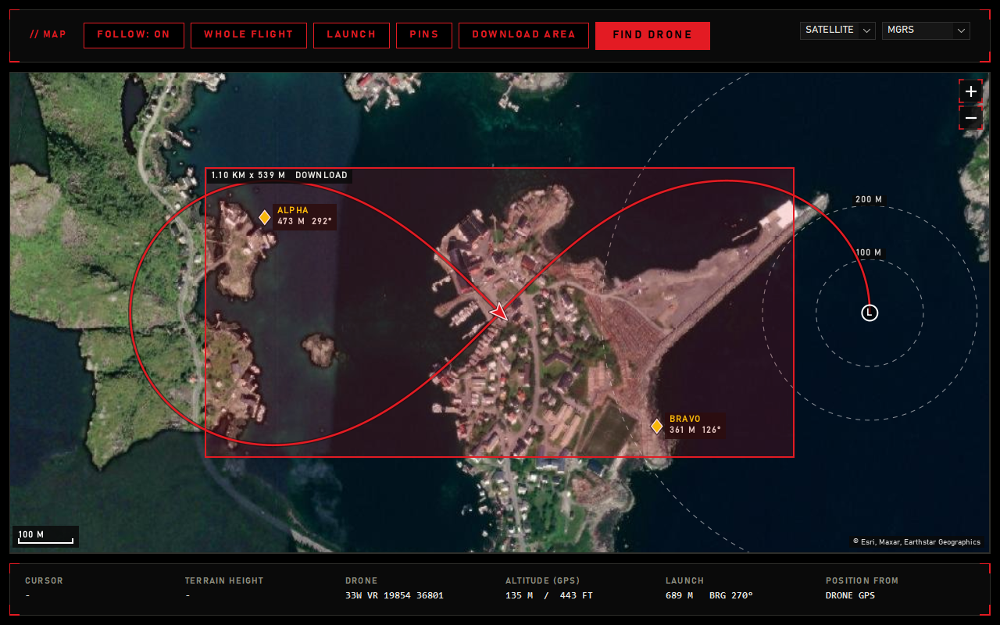
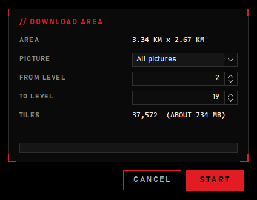
</p>

- **Every flight's path is saved as it comes** to `Documents\DRAUPNE Link\Tracks\track-<date>.gpx` (opens in any map program), with `last-position.txt` beside it: the drone's last known position with MGRS and map links. **TRACKS** draws earlier flights in a muted colour. The graphics live in `Documents\DRAUPNE Link\graphics.kml`, the pins in `pins.txt` next to it.
- **The phone's own position** (MENU > TOOLS > *Position from*): the phone asks the GPS, the network and the fused position, so it has one indoors too, and its screen says what the GPS is doing.

## Watching from a second PC

**MENU > LINK > Allow spectators** on the pilot's PC. A second PC running DRAUPNE Link that connects with **Connect as: Spectator** and picks the pilot PC by name (PCAlpha ...) shows the pilot's video and OSD a little behind (600 ms), can record, and never sends sticks. It follows that PC whatever phone it flies. It uses the pilot's upload (about one video stream each, at most 2 spectators) and pauses by itself when the link to the drone slows down. A spectator never takes the drone over, also when the pilot disconnects. A PC that connects as pilot while another flies becomes a spectator and is told so loudly.

## STANAG 4609 stream

MENU > LINK > **STANAG 4609 stream** (off by default) sends the flight to any player or ground station that follows NATO's motion imagery standard: the video exactly as the phone sends it, in an MPEG transport stream, with **MISB ST 0601** metadata beside it - the time, the drone's position, height, heading, pitch and roll, the camera's angles, and where the picture's centre and corners land on the ground (with an ST 0102 security marking, UNCLASSIFIED). It goes over UDP to the address in **STANAG 4609 settings**: `127.0.0.1:15000` (a player on this PC; in VLC open `udp://@:15000`), a TAK device's Tailscale address, or a multicast address (`239.x.x.x`) for every listener on the local network. ATAK / WinTAK, QGIS's FMV plugin and NATO ground stations show the camera's view on their own map.

The settings also hold the camera's **angle across the picture** (a phone's main camera: about 70 degrees) and its **tilt up** on the frame: the ground the camera sees is worked out from them, the drone's attitude and the terrain. MENU > VIDEO > **Camera view on the map** shows that ground on the map and the minimap, out to 3 km, with a cross where the picture's centre lands.

The stream copies the video (no second encode) on a thread of its own, so the picture on your screen never waits for it. It does use this PC's upload: on a weak one it can delay the sticks - keep it off then, or send it on the local network.

## Latency

Every part is built for the least delay:
- **Sticks:** read and sent 250 times a second in a single step, with no extra queues.
- **Steady timing:** the app holds Windows' 1 ms timer, opts out of power throttling and runs at above-normal priority, so the stick rate holds even when the window is in the background. Without this, Windows can stretch the gaps between stick updates to 16 ms.
- **Video:** each frame is decoded the moment its last packet arrives, and only the newest picture is drawn. The PC side takes about 3–4 ms per 720p frame from the last packet to the screen; the stats line shows the live numbers. The camera runs at a steady 30 fps, the phone paces its packets, and key frames come every 2 s or when the PC asks.
- **Video bitrate:** the PC decides it (up to 4 Mbit/s, 8 in the sharp tier): lowered the moment the ping jumps, before frames get lost, and raised again after 3 s of calm. Mobile networks queue up a too-high bitrate, and queueing is delay. On a really weak link the picture goes to the bad coverage mode (see *Video* above) and back when the link recovers.
- **Measure it:** MENU > TOOLS > *Latency test* shows the whole camera-to-screen delay. Try it in a window and in **F11** full screen.
- **Connection:** Tailscale normally finds a **direct** path. The setup's *Connect DRAUPNE Flight* step tells you if it doesn't.

The 4G network itself (typically 40–100 ms round trip) is the biggest delay. A wired PC helps a little.

**Betaflight setting that matters:** Betaflight handles one MSP message per serial cycle, and that cycle runs only 100 times a second by default. Stick updates plus the OSD's telemetry requests are more than that, so stick updates queue up in the flight controller. MENU > SETUP > *Drone setup* sets it over USB by itself (1000 on F411 boards). Without USB, type this once in Betaflight Configurator's **CLI** tab (Betaflight 4.2 or newer):
```
set serial_update_rate_hz = 2000
save
```

### Poor reception

Nothing in the chain invents stick values: the PC sends the radio's stick positions 250 times a second, unsmoothed, and the phone app forwards only the newest packet it got (late packets after a stall collapse to the newest; nothing is ever re-sent). When packets stop, Betaflight decides:

| Pause in sticks | Betaflight (defaults) |
|---|---|
| under 0.1 s | nothing |
| 0.1-0.3 s | keeps your last sticks, flags RXLOSS (OSD: *RC SIGNAL GAP*) |
| 0.3-1.5 s | sticks centred, throttle to minimum: the drone sinks until the sticks return |
| over 1.5 s | real failsafe: drops and disarms (OSD: *FAILSAFE*) |

For flying where reception is poor, consider in Betaflight: `rxfail 3 h` (hold the last throttle instead of minimum during the 0.3-1.5 s stage, so a short gap doesn't make the drone sink) and **GPS Rescue** as the failsafe procedure (it flies home instead of dropping). Both change how your drone behaves when the link fails, so test them on the bench first. Drone setup offers GPS rescue as the failsafe and sets it only once the GPS answers; with a GPS it also allows arming without a GPS fix (`gps_rescue_allow_arming_without_fix`), so the drone arms indoors too.

## Troubleshooting

| What you see | What it means / what to do |
|---|---|
| The phone isn't in the PHONE list | Open DRAUPNE Flight on the phone (it listens by itself) and check the phone is on Tailscale with mobile data. MENU > LINK > *Name map* > *Ask again* asks every device now |
| The phone asks for **USB permission** every time the flight controller is plugged in | In that Android dialog, tick **Always open DRAUPNE Flight when … is connected**, then OK. Android then lets the Flight app reconnect by itself, without asking, e.g. after a loose cable drops out. Still: a cable that drops out means your sticks don't reach the drone - fix it before flying |
| Phone app: **FC disconnected** | Use a USB-A data cable (many flight controllers ignore USB-C to USB-C), check the phone's **OTG** setting, and tap **Allow** on the USB pop-up |
| **RXLOSS** / **RC SIGNAL GAP** flickers, but nothing happens | The sticks paused for 0.1-0.3 s on their way to Betaflight. Betaflight then flags RXLOSS but keeps your last sticks; it shows the flag for 0.5 s more. Only a pause over 0.3 s matters in the air (sticks centred, throttle to minimum), and over 1.5 s it fails safe and disarms. The [link log](#logs) shows where the pauses come from: the 4G link (ping and telemetry gaps jump), or the flight controller (Betaflight's `serial_update_rate_hz` left at 100 can't keep up - run MENU > SETUP > *Drone setup*) |
| **LINK STALL** | The phone app stopped answering for 0.3 s while the link was up: the 4G link stalled, or the phone is busy. Short ones pass; frequent ones mean poor coverage |
| **Grey or green bands** in the picture, or it breaks up | A weak uplink drops the end of big frames. AUTO video switches to the bad coverage mode by itself after a few stalls; MENU > VIDEO > *Video: ROBUST* keeps it there for the whole flight |
| Landed and still armed, the drone **leans, tilts forward or twitches** | A stick isn't sending 1500 at rest: the controller panel shows ROLL / PIT / YAW values; with your hands off they should read 1500. If not, check the radio's trims and press CALIBRATE again, hands off at the centre step. Even when centred, Betaflight (with Air mode) keeps correcting on the ground, so disarm right after landing |
| **NO FLIGHT CONTROLLER** comes and goes while the link is good | The phone gets nothing from the flight controller: check the USB cable to the flight controller, and run MENU > SETUP > *Drone setup* (a `serial_update_rate_hz` left at 100 also causes it) |
| OSD says **ARMING BLOCKED: ANGLE** | The drone isn't level, or the accelerometer isn't calibrated. Calibrate it in Betaflight Configurator's **Setup** tab, drone level |
| OSD says **ARMING BLOCKED: NOPREARM** | A PREARM switch is set in Betaflight and isn't on. Flip it (AUX3 by default) before ARM, or set PREARM to *Leave as it is* in Drone setup if you have no switch for it |
| Flight app shows the Betaflight version in **yellow** | Betaflight is older than 4.4. It still flies; update when convenient ([which version?](#which-betaflight-version)) |
| Betaflight ignores the **arm switch** | DRAUPNE Link sends your arm switch on AUX1. Drone setup puts ARM there; otherwise, in Betaflight Configurator's **Modes** tab, put ARM on AUX 1. **RC CHECK** shows what Betaflight sees |
| OSD says **ARMING BLOCKED: MSP** | Betaflight Configurator disabled arming and was unplugged without *Disconnect*. Power-cycle the flight controller. Drone setup also clears it |
| **Video is black** | It's what the camera sees: is the lens covered, or is it dark? Point it at something bright. To use another lens, set `cameraId` in the settings (often `2` or `3` is the wide-angle) |
| **PHONE ON TAILSCALE: OFFLINE** in the link card | The phone isn't connected to Tailscale: on the phone, open Tailscale and switch it on, and check it has mobile data. The phone app shows a yellow line for Data Saver, and once a PC is connected for Wi-Fi, Bluetooth and Battery Saver; a tap opens the setting |
| Setup says the path is **relayed** | Tailscale couldn't go direct through your mobile network, which adds latency. Press *Check again* after a minute; the OSD shows RELAY while it stays that way |
| Phone app says **Phone GPS: not allowed**, or *Position from: PHONE* shows nothing | Tap that line on the phone and allow location *While using the app* |
| The map is **blank** out in the field | No internet and nothing saved for that place. Before leaving, open the map at home and use **DOWNLOAD AREA** |
| Channels look wrong | **CALIBRATE**, then **RC CHECK** |

**Versions and updates:** DRAUPNE Link's version is in its window title and at the bottom of MENU > TOOLS (with the phone app version it installs); the phone app shows its version at the bottom right of its screen. Both check GitHub for a newer release (DRAUPNE Link at start and every 6 hours, the phone app when it starts) and say so: an **UPDATE** button in the MENU bar, an *Update available* line in the phone app. Pressing UPDATE downloads the new installer, checks it against GitHub's checksum, closes DRAUPNE Link, installs it (one Windows permission prompt) and starts it again. Tapping the phone's line downloads the new app, checks it and installs it from inside the app, leaving nothing in Downloads (the first time, Android asks you to allow it to install apps). Neither updates while connected to the drone, and nothing is installed without you pressing it. After an update that brought new parts, DRAUPNE Link offers a short tour of just those, once.

Settings live in `%APPDATA%\DraupneLink\draupne-link.properties`.

### Logs

**Link log:** every connection writes a timeline to `%APPDATA%\DraupneLink\logs\link-<date>-<time>.csv`, 10 rows a second: ping, stick frames sent and the longest gap between them, telemetry packets and the longest gap, the flight controller's last data, RXLOSS / FAILSAFE as Betaflight reports them, radio present, the stick values sent (throttle and every channel), the highest round trip and the age of the last reply (pings go out 20 times a second, so stalls of 0.1 s show), Tailscale's path to the phone (direct or relayed), what the phone app sees (gaps between stick packets arriving and stick writes reaching the flight controller, slowest USB write), the video (camera fps, bitrate and its steps, damaged, lost and rebuilt frames, decode and draw times, resolution, bad coverage mode), the phone's own position, plus every log message. It shows which part of the chain a failsafe came from. The newest 20 are kept.

**App log:** `%APPDATA%\DraupneLink\logs\app-<date>.log` has the window's log, errors, and every thread's stack when the window stops responding, for crashes and freezes.

## How it works

```
Radio --USB--> Windows PC  ==== 4G / Tailscale ====>  Android phone on the drone --USB (MSP)--> Betaflight
               DRAUPNE Link  <== video + telemetry ==  DRAUPNE Flight app
```

DRAUPNE Link replaces [DroidDrone](https://github.com/DroidDrone/DroidDrone)'s *Control* phone app. It speaks the protocol of **DroidDrone Flight 2.3.0**, and compiles upstream's own protocol code from a pinned submodule, so it can't drift from the original.

### The phone app

The setup installs **DRAUPNE Flight** (2.3.0-pc.30): upstream's Flight 2.3.0 with these changes, source in [`flight-app/`](flight-app):
- **A name, not an address:** the phone listens for the PC by itself as soon as the app is open, gets its name from the PC and shows it on its status card (a tap picks one by hand, a long press copies its Tailscale address). The button is START / STOP; port and key sit under *Advanced*.
- **Says what is wrong in yellow:** Data Saver, and once a PC is connected, Wi-Fi on, Bluetooth on, Battery Saver off; a tap opens the setting.
- **Every flight controller:** its USB list covers any flight controller with native USB (STM32, AT32, APM32, GD32, RP2040; Betaflight, INAV, ArduPilot, PX4) and every USB-serial bridge chip it can drive (CH340/CH341, CP210x, FTDI, PL2303). Android can then remember the USB permission, and the phone reconnects to the flight controller without asking. Upstream only lists a few IDs, so AT32 boards, for example, needed a tap after every reconnect.
- **Sticks reach the flight controller on time:** upstream reads from the flight controller in a way that, on many phones, holds every USB write for up to 0.1 s, which makes Betaflight flag RXLOSS and block arming; this build reads asynchronously. The newest sticks also always go first, never queued behind a slow request; after a USB glitch it reconnects at once; and the phone reports what it sees into the PC's link log.
- **Video that survives weak 4G:** a steady 30 fps, packets paced instead of sent in bursts, key frames every 2 s and whenever the PC asks, the PC deciding the bitrate, a sharp 1080p tier when the link is calm, and the bad coverage mode (a small picture, key frames twice, a parity packet per group of packets). The video runs on a thread of its own, so camera trouble can never hold up the sticks.
- **Standby and deep sleep:** the PC can rest the phone before take-off; in deep sleep the phone wakes every few minutes, says *still here* with its battery for the whole check window, and comes back when the PC calls.
- **Its own position:** the phone's GPS, network and fused position go to the PC for the map, and the screen says what the GPS is doing.
- **Touch lock for flying:** a yellow **LOCK SCREEN** button covers the screen so stray touches do nothing (hold the box for two seconds to unlock); the screen dims and the link keeps running. Portrait as well as landscape.
- **The PC app's look:** black and red, status at a glance (OFFLINE / WAITING / LINK READY), the same boot animation.
- **Says its version** once a second, so DRAUPNE Link can warn when the phone runs an older app than it brings, and **updates itself** from the *Update available* line. Tells a second PC which PC flies (spectator mode).
- **Replaces any earlier DroidDrone Flight:** it has its own package name (`de.droiddrone.flight.pc`), so it installs next to the original, and when it opens it asks Android to remove the earlier one: one tap on OK.

Every DRAUPNE Link release includes the phone app as `DRAUPNE-Flight-<version>.apk`, the exact build that version installs.

## For developers

Picking up the work (state, rules, build environment, release steps): [docs/HANDOFF.md](docs/HANDOFF.md).

```powershell
git clone --recurse-submodules https://github.com/MelonNO/draupne-link
cd draupne-link
.\gradlew.bat test               # 320+ tests: protocol, video, telemetry, calibration, Betaflight CLI, setup, names, spectators, map, map tools
.\gradlew.bat installDist        # build\install\draupne-link\bin\draupne-link.bat
.\gradlew.bat releaseZip         # portable zip (app + Java runtime)
.\gradlew.bat packageInstaller   # installer, needs WiX Toolset 3
```
Needs JDK 21. To release, set `version` in `build.gradle`, put that version's changes in [`docs/RELEASE_NOTES.md`](docs/RELEASE_NOTES.md) (the release page shows only those) and add them to [`docs/CHANGELOG.md`](docs/CHANGELOG.md), then push a tag `v<version>`. GitHub Actions builds and publishes the installer and the zip, and attaches the phone app pinned in `ApkShare.java` (see [`flight-app/`](flight-app)).

| Package | What's in it |
|---|---|
| `de.droiddrone.pc` | Link (`ControlLink`), DRAUPNE names (`Names`, `NameService`), joystick, calibration, RC mapping, telemetry (`FcTelemetry`), link log, spectator mode, app log |
| `de.droiddrone.pc.video` | Frame reassembly, parity recovery, FFmpeg decoder, bitrate control and the video tiers, low-latency pipeline |
| `de.droiddrone.pc.map` | Web Mercator, tile sources and the tile cache (offline, DOWNLOAD AREA), MGRS / UTM, terrain height and elevation profiles, GPX tracks, pins, graphics and KML |
| `de.droiddrone.pc.setup` | Tailscale, firewall, power plan, shortcuts, Betaflight over USB (CLI, switches, PREARM, failsafe), Flight app download/serving, updates |
| `de.droiddrone.pc.gui` | Main window, MENU, OSD, map window and map tools, unit symbols, setup wizard, calibration, RC check, motor test, name map, tour, boot animation |

More: [protocol notes](docs/PROTOCOL.md) and [roadmap](docs/ROADMAP.md).

## License

GPL-3.0, the same as DroidDrone, whose code this build includes. Third-party components and their licenses are listed in [THIRD-PARTY.md](THIRD-PARTY.md).
