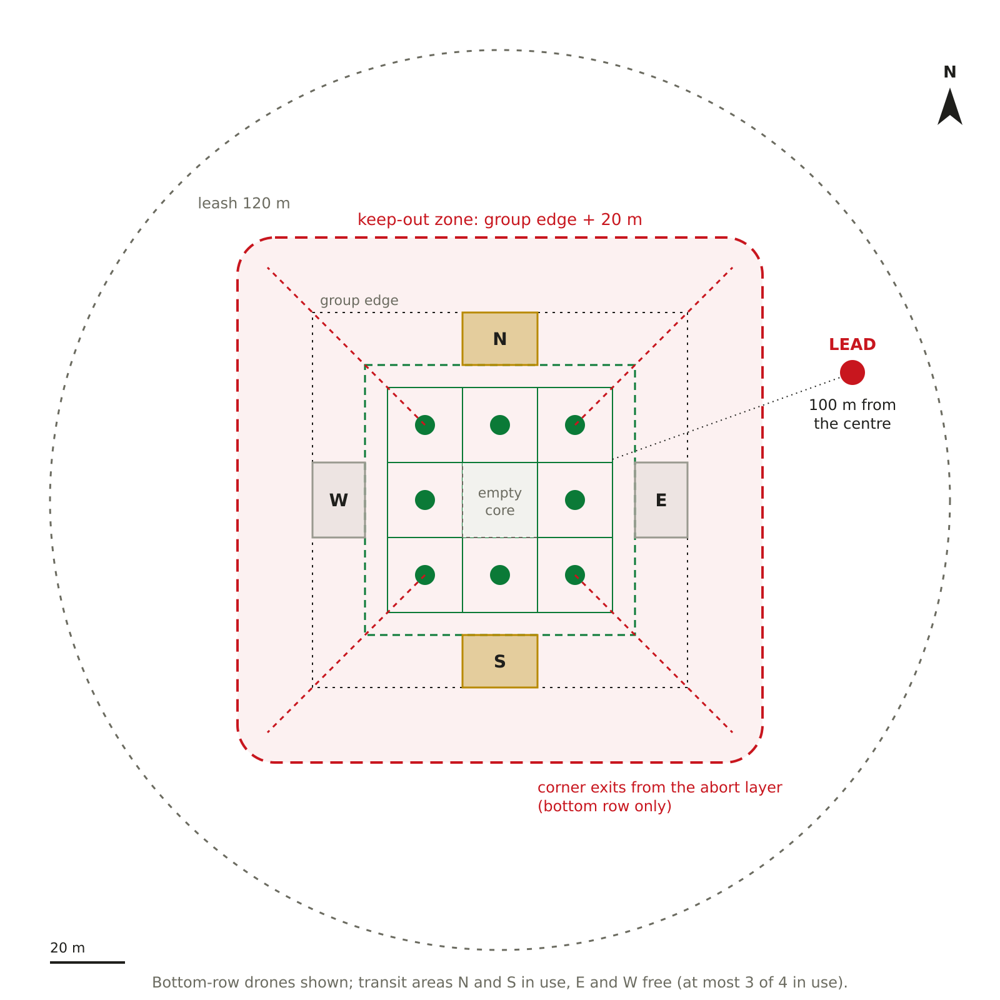
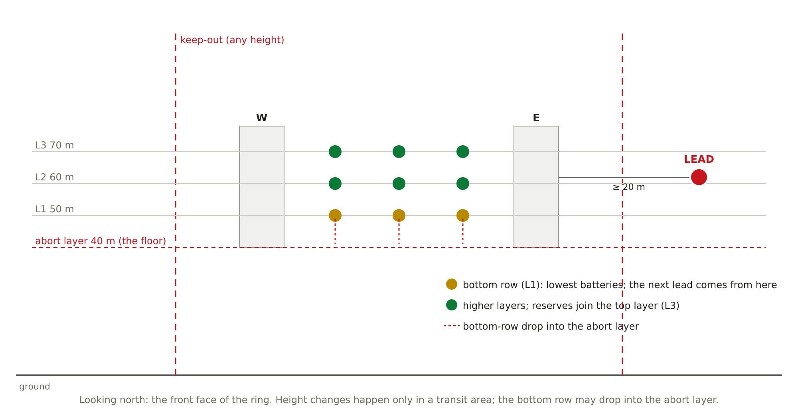
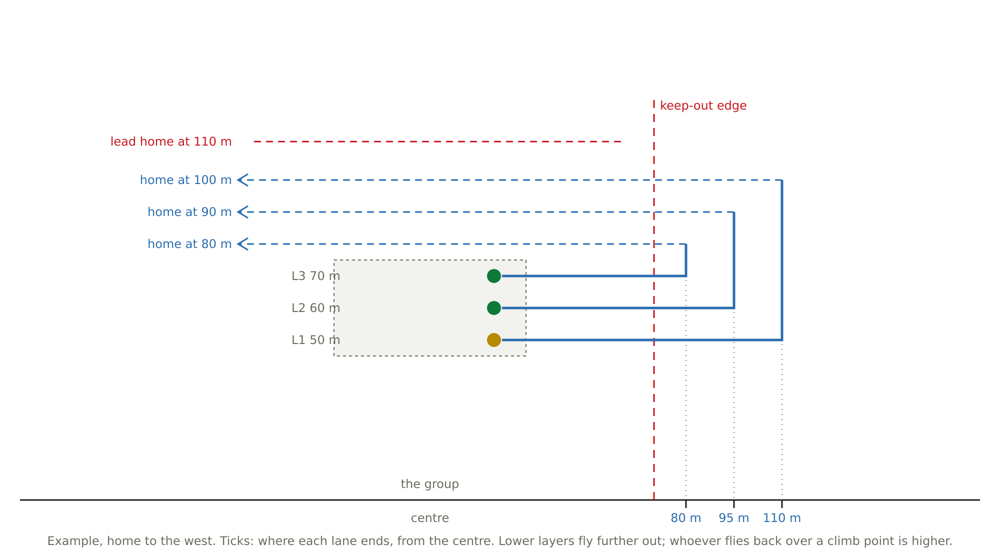

# DRAUPNE Fleet & ArduPilot

Product requirements: GNSS-enabled and GNSS-denied fleet management

| Item | Detail |
|---|---|
| Document | Product requirements document (PRD) |
| Product | DRAUPNE Link: PC app and DRAUPNE Flight phone app |
| Version | 1.0 draft |
| Date | 23 November 2026 |
| Status | 72 of 81 decisions made. Open decisions show their recommended choice and are listed at the end. Nothing in this document has been flown yet. |

**Source of truth**

Solution Workbook (decisions and requirements) and GUI mockup: kept by the maintainer (links in the private notes, not here).

Every decision and requirement here was generated from the workbook with the pilot's saved choices. If the two disagree, the workbook wins and this document is regenerated.

# Summary

DRAUPNE Link adds ArduPilot as a second flight-controller type and manages a fleet of drones from one pilot's PC. The work comes in two stages. **Stage 1** is GNSS-enabled fleet management: terrain-following routes, fleet dispatch, follow-the-leader with DISCARD LEAD, and safe autolaunch of reserves. **Stage 2** is GNSS-denied management: the same fleet when GNSS is jammed or gone, kept on position by dead reckoning and fixes. Betaflight stays the default for today's drones.

**Shared non-goals**
- ArduPilot on boards under 1 MB flash (such as the iFlight Blitz F722).
- Freestyle or acro tuning on ArduPilot.
- Drone-to-drone avoidance beyond planned separation and ArduPilot's own avoidance.

# How the follower group flies

This chapter is an overview of the follower group with today's settings. The binding text is in the stage 1 requirements (areas E, F and K); the IDs in brackets point to them.

## Roles

- The pilot flies one drone, the **lead**, with sticks over 4G. Only the lead gets sticks; followers fly in ArduPilot's FOLLOW mode and never take stick overrides (FL-7).
- **Followers** keep a group near the lead rather than a formation on it. While the lead is within the leash (120 m from the group's centre), turning, circling or hovering moves no follower. When it goes further, the whole group moves straight toward it and stops 100 m from it; followers never race round to get behind the lead (FL-12).
- **Reserves** are landed drones in deep sleep or overwatch that the pilot has marked SAFE TO AUTOLAUNCH. CALL RESERVE sends the one that would arrive first (area F).

## The hollow cube

Figure 1. The group from above: the ring of cells round an empty core, the outer lane, the four transit areas, the corner exits, the keep-out zone and the leash.
- Each layer is a ring of 3 × 3 cells with an empty core: 8 drones per layer, cells 20 m apart, fixed to the compass so the group never turns with the lead. Layers are 10 m apart; 20 followers fill three layers (8 + 8 + 4) (K3, AC-16).
- The abort layer sits at the floor (40 m); the cube starts one layer higher (K14).
- **Battery order:** lowest batteries at the bottom, highest at the top. The next lead is the bottom-row drone with the lowest battery; reserves join at the top. The order is checked only when a drone enters or leaves the cube, or every 5 minutes, whichever comes first, and a drone changes layer only when it has to (AC-30).
- **Transit areas:** four, N, E, S and W, just outside the ring. One drone per area and at most three in use, so one is always free for a drone that must hop from one area to the next. Height changes happen only inside a transit area. A drone on the north side that must get to the south goes into N, then E or W (whichever is free), then S, finds its layer and enters its cell (AC-27, K9).
- **Abort layer:** for the bottom row only. A bottom-row drone drops straight into it and leaves diagonally through a corner exit without using a transit area: the new lead after DISCARD LEAD, and drones landing at 3 %. If three transit areas are in use when a drone must land at 3 %, it takes the free fourth one (K10).
- **Keep-out zone:** 20 m round the group's whole edge (cells, outer lane and transit areas), at any height. When the lead nears it, the pilot gets TRAFFIC on the OSD with distance and direction, and the group moves away as one (K4, AC-34). The distance kept from the lead must be at least half the group's width + outer lane + transit area + keep-out (AC-35).
- **On the move:** hops, height changes, joins and exits all work while the group follows the lead; during any of them the group moves no faster than 8 m/s. If any drone stops or switches to LOITER, the whole group stops until that drone is normal again or the group has moved clear of it (AC-39, AC-40).

Figure 2. The group from the side, looking north: three layers in battery order, the abort layer at the floor, the west and east transit areas, and the keep-out zone.

## Changing the lead

- DISCARD LEAD is a dedicated radio switch, with no dialog (E4). The new lead is the bottom-row follower with the lowest battery; its full video shows within 1.5 s. It starts in auto, moving out through the abort layer, and the pilot may take manual control at any moment (K12). The old lead keeps its current mode (E3), and the gap in the bottom row is filled at once (E5).
- If the lead is silent for 30 s, the follower that DISCARD LEAD would pick becomes the lead and the pilot gets its sticks (FL-5).

## Reserves (safe autolaunch)

- CALL RESERVE is a radio switch; each press queues one more marked drone, the one that would arrive first counting its check-in wait, wake-up, vertical climb and flight (AL-6), up to 10 km away.
- Before the motors start, the drone must sit level within 45 ° and its mark must still be valid; then a 2 s beep and launch (FA11). It climbs straight up in its own cleared column to an approach layer of its own. A watchdog on the phone stops the motors at once on tilt over 50 °, an impact over 3 g, a climb stalled for 4 s and the other crash signs in AL-14; the pilot is alerted and the next reserve is called (FA16, FA17).
- Its camera shows as a mini-view in the bottom-left corner of the pilot's video once it has connected, and disappears when it passes the floor.
- It flies to the group in its approach layer following the terrain (FA7), comes down a free transit area and takes a new cell at the top (FA8). Several reserves may climb at once (FA20).

## Link loss and the exit plan

- **The lead** (and any drone on its own): the phone brakes it into LOITER within about 100 ms; after 20 s without the PC it goes home. A drone on its own uses Smart RTL; a lead with a group uses plain RTL, climbing first to one layer above the highest follower return height, because the group trails on the lead's own path (AP-5, AC-41).
- **A follower** can't tell whether only it is cut off or the PC is gone, so it always does the same: it loiters in its cell for 2 minutes, then flies its exit plan. If its link returns within the 2 minutes it stays (AC-37).
- **The exit plan:** straight out from the group's centre through its own cell, in its own layer, past the keep-out zone (lower layers further out); then up to its own return height and home by plain RTL to its own rally point. In a hollow cube every drone has a free outside, so the lanes point away from each other. The PC refreshes every plan every 10 s and at every change in the group, and checks each set for conflicts before sending it (AC-36).
- **Only one drone cut off:** a moving group stops at once. After 30 s the rest of the group moves 20 m away from it, re-forms and carries on following the lead; if the lead reaches the keep-out zone during those 30 s, the group moves away at once. The PC keeps the lost drone's lane, climb and way home clear until it has gone (AC-37).
- **The PC gone:** every follower loiters; after 2 minutes they all leave along their lanes at the same time, with no order needed. Drones already on their way home when a link returns keep going unless the pilot calls them back; called back, they rejoin like a reserve (AC-37, AC-38).
- **3 % battery during the wait:** a bottom-row drone lands straight down; any other flies out along its lane and lands at its end (AC-37).

Figure 3. Exit plan seen from the side, for drones on one side of the group with home to the west.

## GNSS loss

- **One follower loses GNSS:** it can't loiter or go home without GNSS, so it holds its height and drifts with the wind. A moving group stops, then moves away at once, upwind and sideways, keeping clear of the drone's estimated position and its growing error circle. Then the drone does this: hold height and wait for the pilot (K19). If its GNSS returns, it rejoins through a transit area (AC-42).
- **Two or more lose GNSS at once:** treated as GNSS lost for the whole group (AC-20). Card K8 is still open; the recommendation is to land column by column, bottom first.
- **Outside a group:** everyone holds height and waits (A5).
- **Battery** never sends a drone home: the only battery action is LAND at 3 % (AP-14).

## Key numbers

| Setting | Value | Card |
|---|---|---|
| Route height above ground | 60 m | B1 |
| Follower floor (the abort layer) | 40 m | E1, K14 |
| Spacing between layers | 10 m | K1 |
| Horizontal protection radius | 10 m | K2 |
| Cell size | 20 m | E11 |
| Cells per side of a hollow layer | 3 cells (open) | K11 |
| Distance the group keeps from the lead (from its centre) | 100 m | E10 |
| Leash (lead distance that starts the group moving) | 120 m | E12 |
| Keep-out zone from the group's edge | 20 m | K15 |
| Move away from a lost drone | 20 m | K16 |
| Group speed during a move inside the group | 8 m/s | K17 |
| Transit areas | 4, at most 3 in use | AC-27 |
| Order check | at every enter or exit, else every 5 min | AC-30 |
| Lead silent before a follower takes over | 30 s | E7 |
| Lead hold before going home | 20 s | A4 |
| Follower hold after a lost link | 2 min | AC-37 |
| Exit plan refresh | 10 s (open) | K20 |
| Battery action | LAND at 3 %, no battery return | AP-14 |
| Furthest reserve call | 10 km | FA9 |
| Largest tilt before arming | 45 ° | FA13 |
| Tilt that aborts the climb | 50 ° | FA14 |
| Stalled climb allowed | 4 s | FA15 |
| Height ceiling | No ceiling | K21 |

# Stage 1: GNSS-enabled fleet management

**Goals**
- One pilot sends, flies and recovers several drones from one PC.
- Routes follow the terrain with no terrain data stored on the drone; one height above ground, default 60 m.
- A group of followers stays close to the piloted lead and only moves when the lead is more than 120 m away; followers never go below 40 m, and DISCARD LEAD hands the sticks at once to the next lead, the lowest-battery follower in the bottom row.
- While flying, each press of CALL RESERVE queues one more marked drone, the one that would arrive first: it climbs straight up, flies to the group and joins as a follower through a transit area, with crash detection before and during the climb.
- A drone that loses GNSS does something defined at once (everyone holds height and waits).
- ArduPilot drones are set up in DRAUPNE's own guide, and the tour shows every new feature on virtual drones.
- Followers fly as a hollow cube beside the lead, ordered by battery, with four transit areas, a bottom-row abort layer and a keep-out zone the lead can't enter.
- No two DRAUPNE drones ever come closer than the protection radius sideways and the layer spacing in height, in any situation the bench can produce, including link or GNSS loss (area K).
- Latency first: nothing adds delay to the piloted drone's sticks or video.

## Stage 1 decisions

### A · ArduPilot base

| ID | Decision | Choice | Status | Why |
|---|---|---|---|---|
| A1 | Which board runs ArduPilot first? | all ardupilot boards | Decided | all available ardupilot FC's |
| A2 | Stick rate to ArduPilot | Does not matter | Decided |  |
| A3 | First action when the PC goes silent | Phone brakes into LOITER | Decided |  |
| A4 | Hold time before going home after a link loss | 20 s | Decided |  |
| A5 | What a drone does when GNSS is lost (stage 1) | Everyone holds height and waits | Decided |  |

### B · Terrain-following routes

| ID | Decision | Choice | Status |
|---|---|---|---|
| B1 | Height above ground for routes | 60 m | Decided |
| B4 | Altitude reference in the uploaded mission | Absolute (above sea level) | Decided |
| B5 | What the drone does at the end of a route | Hold and call the pilot | Decided |
| B6 | How the drone comes home over terrain | Reversed route in the mission | Decided |

### C · Fleet dispatch

| ID | Decision | Choice | Status |
|---|---|---|---|
| C1 | Most drones per pilot | no limit | Decided |
| C3 | Video from drones not being flown | Small stream on demand | Decided |
| C4 | Stick pickup when control moves to another drone | Centred pickup | Decided |

### E · Follow the leader

| ID | Decision | Choice | Status |
|---|---|---|---|
| E1 | Default follower minimum height (the floor) | 40 m | Decided |
| E2 | What the floor is measured from | Above the ground under each follower | Decided |
| E3 | What the old lead does after DISCARD LEAD | keep current mode | Decided |
| E4 | How DISCARD LEAD is triggered | Dedicated radio switch | Decided |
| E5 | The group after DISCARD LEAD | Fill the gap at once | Decided |
| E6 | How the lead's position reaches each follower | 4G via the phones | Decided |
| E7 | How long the lead may be silent before a follower takes over | 30 s | Decided |
| E8 | Shape of each layer | Block distrubuted evenly | Decided |
| E10 | Distance the group keeps from the lead | 100 m | Decided |
| E11 | Spacing inside the group (cell size) | 20 m | Decided |
| E12 | Leash: distance that starts the group moving | 120 m | Decided |
| E13 | Which way the followers point | At the lead | Decided |
| E14 | What the pilot can set from the map | One floor for the group | Decided |

### F · Safe autolaunch

| ID | Decision | Choice | Status |
|---|---|---|---|
| FA1 | Which drones can be marked safe to autolaunch | Any landed drone | Decided |
| FA2 | What the app checks before a marked drone may launch | Battery, GPS, FC health, mark still valid | Decided |
| FA3 | When a mark is cleared by itself | When the drone moves, launches or is marked OUT OF ACTION | Decided |
| FA4 | How the pilot calls a reserve | A radio switch | Decided |
| FA6 | How fast a marked drone hears the call | Keep the shared interval | Decided |
| FA7 | Height for the flight to the group | Its approach layer, following the terrain | Decided |
| FA8 | Which cell a reserve takes | Always a new cell at the top | Decided |
| FA9 | Furthest a reserve may be called from | 10 km | Decided |
| FA10 | If the call is cancelled or the group is lost on the way | Join whoever is the lead now | Decided |
| FA11 | Warning before the motors start | 2 s beep, then launch | Decided |
| FA13 | Largest tilt allowed before arming | 45 ° | Decided |
| FA14 | Tilt that aborts the vertical climb | 50 ° | Decided |
| FA15 | How long a stalled climb is allowed | 4 s | Decided |
| FA16 | What the drone does when the climb fails | Motors off at once, always | Decided |
| FA17 | After a failed launch | Alert the pilot, call the next reserve | Decided |
| FA18 | Beeping after a failed launch | Silent until marked OUT OF ACTION | Decided |
| FA20 | Several reserves climbing at once | Stack them no limit | Decided |

### K · Airspace coordination

| ID | Decision | Choice | Status |
|---|---|---|---|
| K1 | Vertical spacing between height layers | 10 m | Decided |
| K2 | Horizontal protection radius | 10 m | Decided |
| K3 | How a follower group is stacked | Hollow cube with four transit areas | Decided |
| K4 | When the lead heads for the group or another drone | Warn the pilot, the group gives way | Decided |
| K5 | Separation backstop without the PC | Exit plans only | Decided |
| K6 | Drones per layer in a full cube | 4 drones | Decided |
| K8 | GNSS lost while drones share a layer | Land column by column, bottom first | Open (recommended) |
| K11 | Cells per side of a hollow layer | 3 cells | Open (recommended) |
| K9 | Which way round a drone hops to the far side | Whichever next area is free | Decided |
| K10 | A drone landing at 3 % when three transit areas are in use | It takes the free fourth area | Decided |
| K14 | Where the abort layer sits | At the floor; the cube starts one layer higher | Decided |
| K12 | When the new lead gets the sticks | it starts in auto moving out to the abort layer, the pilot may at any point change the mode to manually controll the drone | Decided |
| K15 | Minimum distance from the lead to the group's edge | 20 m | Decided |
| K16 | How far the group moves away from a drone that lost its link | 20 m | Decided |
| K17 | Group speed while a move inside the group is going on | 8 m/s | Decided |
| K19 | A drone that lost GNSS in the group, once the group is clear of it | Hold height and wait for the pilot | Decided |
| K20 | How often the PC refreshes each follower's exit plan | 10 s | Open (recommended) |
| K21 | Height ceiling | No ceiling | Decided |

### G · Pilot GUI

| ID | Decision | Choice | Status |
|---|---|---|---|
| G1 | Where the new fleet controls live | In FLEET rows and map right-click | Decided |
| G2 | Mode controls while flying an ArduPilot drone | Radio mode switch, OSD buttons as backup | Decided |
| G3 | How the new alerts show | Banner and sound for critical, FLEET line for the rest | Decided |
| G4 | The follower group on the map | Label plus leash ring | Decided |
| G5 | Words on screen for the drones | LEAD / FOLLOWER | Decided |

### H · ArduPilot setup guide

| ID | Decision | Choice | Status |
|---|---|---|---|
| H1 | How ArduPilot gets onto the flight controller | The guide flashes it | Decided |
| H2 | Tuning | Frame presets, AUTOTUNE as an option | Decided |
| H3 | Accelerometer calibration | Six positions with the 3D drone | Decided |
| H4 | Converting a drone from Betaflight | Carry over what transfers | Decided |
| H5 | Where the ArduPilot guide starts | Same guide, branches after the FC is detected | Decided |

### I · Tour

| ID | Decision | Choice | Status |
|---|---|---|---|
| I1 | How the tour shows the new features | New steps, plus WHAT'S NEW | Decided |
| I2 | What flies in the tour | Virtual drones flying live | Decided |
| I3 | Failures in the tour | Leave them out | Decided |

### J · Docs and release

| ID | Decision | Choice | Status |
|---|---|---|---|
| J1 | Language on screen | English only | Decided |

## Stage 1 requirements

### A · ArduPilot base

| ID | Requirement | Priority |
|---|---|---|
| AP-13 | First ArduPilot hardware: all ardupilot boards. ArduPilot Copter 4.6+ (4.7+ for follow), 1 MB+ flash. | Must |
| AP-14 | GNSS loss in stage 1: OSD and FLEET show GNSS LOST at once; everyone holds height and waits. Battery rules stay (LAND only at 3 %). | Must |
| AP-1 | Detect the flight controller type per drone (Betaflight/INAV over MSP, ArduPilot over MAVLink) and show it in FLEET and Drone setup. | Must |
| AP-2 | The PC reads the phone's MAVLink records into the objects the HUD, map, FLEET and STANAG use. An unknown record is skipped by its length and never ends the packet. | Must |
| AP-3 | Armed state, flight mode name and every PreArm text shown in RC CHECK as the reason a drone won't arm. | Must |
| AP-4 | Sticks go to ArduPilot as RC_CHANNELS_OVERRIDE at Does not matter; Betaflight keeps 250 Hz MSP. One drone receives sticks at a time. | Must |
| AP-5 | Link loss (the lead and drones on their own; followers in a group: AC-36 to AC-38): Phone brakes into LOITER; after 20 s without the PC the drone goes home by Smart RTL; a lead with a follower group uses plain RTL instead (AC-41). A PC heartbeat relayed by the phone drives ArduPilot's GCS failsafe as the backstop. | Must |
| AP-6 | OSD mode buttons: LOITER, RTL, LAND, and START/PAUSE for a mission. | Must |
| AP-7 | Drone setup over MAVLink parameters with backup (.param), plan, CONFIRM and read-back: ports, GPS, compass, calibrations, orientation, arm and mode switches, beeper, battery failsafe (warning only; LAND at 3 %), motor test and order, a unique SYSID_THISMAV. | Must |
| AP-8 | Test bench: virtual drones backed by ArduPilot SITL, several at once, with link impairment and GPS switched off. | Must |
| AP-9 | Geofence from AIRSPACE areas and map rectangles, uploaded to the drone. | Should |
| AP-10 | Flight log download after landing, shown on PREVIOUS FLIGHTS' timeline. | Should |
| AP-11 | MAVLink bridge so Mission Planner or QGroundControl can tune a drone over the link. | Could |
| AP-12 | Overwatch alert → "go look": fly to the alert's grid and point the camera at it (DO_SET_ROI). | Could |

### B · Terrain-following routes

| ID | Requirement | Priority |
|---|---|---|
| RT-1 | Route editing on the map: add, move, insert, delete, reverse, save and load points, each numbered with an optional height override. "Fly to here" = a one-point route from the drone. | Must |
| RT-2 | Terrain sampled every 10 m or less along each leg from DRAUPNE's elevation data, offline when the area is downloaded. Upload is refused if any sample is missing. | Must |
| RT-3 | One number sets the route's height: the drone never flies lower than 60 m above the ground (default for new routes). The PC adds waypoints wherever a straight leg would come lower, and drops waypoints that change the line by less than the pilot's smoothing setting. | Must |
| RT-4 | No leg steeper than the drone climbs or descends at cruise speed (WP_SPD_UP, WP_SPD_DN against WP_SPD); the climb starts early enough to clear a ridge. | Must |
| RT-5 | Altitudes uploaded above sea level from the map's datum; the PC checks the drone's reported altitude at home against the terrain there. | Must |
| RT-6 | No automatic margin for forest or buildings. Elevation data is bare ground, and the pilot raises the height where needed. The route view says the height is above bare ground. | Must |
| RT-15 | Route settings the pilot adjusts, saved with each route: height above ground (starts at 60 m), a height per point, and smoothing (how far above the set height the line may run to save waypoints, default 5 m). Climb and descent limits come from the drone's own speed parameters. | Must |
| RT-7 | Profile before upload: terrain, flight line, lowest clearance, distance, flight time, battery including the return, and stretches without 4G coverage. | Must |
| RT-8 | Upload with the MAVLink mission protocol, read back item by item before START. At the end the drone will hold and call the pilot. | Must |
| RT-9 | Return over terrain: reversed route in the mission. RTL_ALT is always set above the highest ground on the straight line home, so a failsafe RTL clears it too. | Must |
| RT-10 | No terrain data on the drone: routes fly with TERRAIN_ENABLE = 0, no SD card and no terrain requests over the link. | Must |
| RT-12 | One route can be sent to several drones, each on its own height layer or time slot. | Should |
| RT-14 | Power lines and masts from map data shown along the route, so the pilot can raise the height there. | Could |

### C · Fleet dispatch

| ID | Requirement | Priority |
|---|---|---|
| FD-1 | A light command link to every drone stays up while one is piloted (heartbeat, mode, targets, telemetry at 1–2 Hz). Video from the others: small stream on demand. | Must |
| FD-2 | Per-drone state in FLEET and on the map: TRANSIT, HOLDING, YOUR TURN, RETURNING, and battery left after the trip home. | Must |
| FD-3 | DISPATCH sends up to no limit drones per pilot: each gets a slot around the area, its own height layer (AC-2) and a terrain route, with staggered launches through cleared columns (AC-4). | Must |
| FD-4 | Arrival queue. TAKE CONTROL moves the sticks to the next drone, already in LOITER, with centred pickup. RELEASE puts it back in LOITER or sends it home. | Must |
| FD-5 | Battery never sends a drone home. The app warns: FLEET and the OSD show the time left and HOME NOW when the trip home needs the rest of the battery. The only automatic battery action is LAND where it is at 3 % (BATT_FS_LOW_ACT = none, BATT_FS_CRT_ACT = Land, the critical level set to 3 % on the Li-ion curve). Battery never blocks arming. | Must |
| FD-6 | Link loss: a dispatched drone on its own follows AP-5. Drones in a group follow AC-36 to AC-38. Return routes and heights are planned to keep clear of each other. | Must |
| FD-7 | Uplink budget: the piloted drone's video comes first; other drones' pictures never push it down a quality tier. | Must |
| FD-8 | Separation backstop: each drone gets the others' positions as ADSB_VEHICLE so ArduPilot's avoidance can react. | Should |
| FD-9 | Dispatch planner preview: transit, waiting, piloted and return time per drone, and which drones will run low before the pilot reaches them. | Should |

### E · Follow the leader

| ID | Requirement | Priority |
|---|---|---|
| FL-1 | FOLLOW GROUP: pick the lead and the followers. The group is stacked as hollow cube with four transit areas (AC-16), each layer block distrubuted evenly, cells 20 m apart, fixed to the compass so it never turns with the lead. Followers are ordered by battery, lowest at the bottom (AC-30); the next lead is the bottom-row drone with the lowest battery. | Must |
| FL-12 | Leash: the group stays where it is while the lead is within 120 m of the group's centre; a lead that turns, circles or hovers inside that moves no follower. When the lead goes further, the whole group moves straight toward it and stops 100 m from it (the leash is always at least 10 m more than that). Followers never circle round to get behind the lead. Catch-up speed: up to the drones' top cruise speed, so a racing lead is followed. | Must |
| FL-13 | Followers point at the lead. | Must |
| FL-2 | The lead's position reaches each follower by 4G via the phones. The follower's phone runs the leash and sends GUIDED position targets to its flight controller (ArduPilot's own FOLLOW mode tracks the lead too tightly for this). | Must |
| FL-3 | Follower floor: starts at 40 m above the ground under each follower and is changed live from the map (FL-14). The phone never sets a target below the current floor, whatever the lead does. | Must |
| FL-14 | The floor is adjustable from the map during flight: one floor for the group. On the group's map label: − / + in 5 m steps and a typed value. A change reaches every follower within 2 s, shows on the map and the OSD, and is logged. Raising takes effect at once (followers climb); the floor never goes under 10 m above ground, and above 120 m the map warns about the airspace limit. Reserves called later climb to the floor as it is set at that moment. | Must |
| FL-4 | When the lead lands or disarms, the group holds where it is, in its layers; OSD and FLEET show LEAD DOWN and DISCARD LEAD flashes. | Must |
| FL-5 | Lead silent for 30 s: the follower that DISCARD LEAD would pick becomes the lead at once and the pilot gets its sticks, as with DISCARD LEAD; the group follows the new lead. The silent lead runs its own link-loss procedure (AP-5). If its link comes back, it is treated as a discarded lead (E3). | Must |
| FL-15 | Link loss: the lead and drones outside a group run their own link-loss procedure (AP-5: phone brakes into LOITER, then home after 20 s). Followers in a group follow the group rules instead: one drone lost (AC-37), the PC lost (AC-36), back again (AC-38). | Must |
| FL-6 | DISCARD LEAD by dedicated radio switch, no dialog. The new lead is the bottom-layer follower with the lowest battery; its full video within 1.5 s; sticks it starts in auto moving out to the abort layer, the pilot may at any point change the mode to manually controll the drone, with centred pickup (AC-32). The group now follows the new lead on the same leash and fills the gap in the bottom row at once (AC-30). The old lead will keep current mode. | Must |
| FL-7 | Only the lead gets sticks; a follower never takes RC overrides. | Must |
| FL-8 | Every drone on its own height layer (AC-2); spacing inside the group 20 m, never below the protection radius (AC-6); the lead stays outside the keep-out zone round the group's edge, and the group gives way to it as one (AC-34, AC-19). | Must |
| FL-9 | Group designer: stacking, layer shape, cell size, keep-out and leash, with the size check (AC-35), the layer check (AC-13) and, without GNSS, the camera and UWB limits. | Should |
| FL-10 | Follower status on OSD and FLEET: IN GROUP, CATCHING UP, AT FLOOR, HOLDING, LOST. | Should |

### F · Safe autolaunch

| ID | Requirement | Priority |
|---|---|---|
| AL-1 | SAFE TO AUTOLAUNCH: the pilot marks a drone (FLEET row or right-click on the map) and clears it the same way. Who can be marked: any landed drone. The mark shows on the map and in FLEET. | Must |
| AL-2 | Marking asks the pilot to confirm that the drone can climb straight up to the current follower floor (set on the map; starts at 40 m) with nothing above it. | Must |
| AL-3 | Checks at the moment of the call: Battery, GPS, FC health, mark still valid. A drone that fails is skipped, and the next one is called. | Must |
| AL-4 | A mark is cleared by itself: when the drone moves, launches or is marked OUT OF ACTION. | Must |
| AL-5 | CALL RESERVE while flying the lead, by A radio switch. Each press queues one more drone to the active fleet, so several presses call several drones. The OSD lists the queued drones in arrival order with their arrival times (+3 RESERVES: Sentry-3 1:20 …). The last call can be cancelled from the OSD or FLEET until that drone arms. | Must |
| AL-6 | Each call goes to the marked drone that would arrive first: check-in wait + wake and arm + vertical climb + flight to the group, the smallest wins. The nearest drone answers only when it would also be first; a farther drone with a check-in due soon can beat it. Only marked drones within 10 km of the group count; a drone answers one call. None left: the OSD says NO RESERVE. | Must |
| AL-7 | Waking: keep the shared interval. The launch order is queued for the phone's next check-in, as mode changes are today. | Must |
| AL-8 | Launch: the phone wakes, the FC arms, and the drone climbs straight up in its cleared column to an approach layer of its own above the group's top layer (AC-5); its mini-view leaves once it passes the follower floor (set on the map; starts at 40 m). It flies to the group in that layer, its approach layer, following the terrain, then comes down a free transit area to its cell (AC-27). | Must |
| AL-9 | Joining: FOLL_SYSID = the current lead, cell = always a new cell at the top. Status in FLEET and on the OSD: CALLED, WAKING, CLIMBING, ON THE WAY, WAITING FOR TRANSIT, IN TRANSIT, IN GROUP. | Must |
| AL-10 | If the call is cancelled or the group is lost on the way: join whoever is the lead now. | Must |
| AL-12 | Safety: only a marked drone ever arms by itself, and only on the pilot's call; queued drones launch from their own spots without waiting for each other, each in its own approach layer, and take transit areas and cells in the order they arrive; before the motors start: 2 s beep, then launch. Every autolaunch is logged and kept in PREVIOUS FLIGHTS. Battery rules stay: no battery return, LAND at 3 %. | Must |
| AL-13 | Check before arming, when the drone wakes: tilt within 45 ° of level (upside down or on its side never arms); within 10 m and 30° of heading of where it was marked; no motion in the last 5 s (not being carried); IMU and compass healthy. A failure means no arming, the mark is cleared, and the pilot sees MOVED or TIPPED with the phone's picture and grid. | Must |
| AL-14 | Climb watchdog on the phone (no 4G round trip) for the whole vertical climb: abort on tilt over 50 °, an impact over 3 g (FC or phone accelerometer), a climb under 0.5 m/s for 4 s, motors near full for 2 s without climbing, drift over 3 m sideways, or a motor RPM drop where ESC telemetry exists. | Must |
| AL-15 | ArduPilot's own checks stay on as the backstop: crash check (FS_CRASH_CHECK = disarm), thrust loss and vibration failsafes. | Must |
| AL-16 | When the climb fails: motors off at once, always. | Must |
| AL-17 | After a failed launch: alert the pilot, call the next reserve. The phone records the launch; the clip, the reason and the flight log are kept in PREVIOUS FLIGHTS. | Must |
| AL-18 | Beeper after a failed launch: silent until marked OUT OF ACTION. | Must |
| AL-19 | Bench tests in SITL for every case: upside down, moved 20 m, rotated, carried, branch strike, stuck in a tree, and a gusty climb that must NOT abort. | Must |
| AL-20 | Launch mini-view: while the pilot flies and a reserve autolaunches, a small live view of that drone's camera shows in the bottom-left corner of the pilot view (about a fifth of its width), with the drone's name, status and a height bar up to the current follower floor (set on the map; starts at 40 m). It appears only once the drone has woken and connected, never before; until then the drone shows only in the reserve list at the top of the view (CALLED, with the time to its check-in). It disappears when the drone reaches the floor. Several at once: stack them no limit. | Must |
| AL-21 | Mini-view rules: a small stream (about 480×270 at 15 fps) that never pushes the piloted drone's video down a quality tier; if the watchdog aborts, it stays with LAUNCH FAILED and the last picture for 10 s, then becomes the alert in FLEET; the OSD layout editor keeps the corner free and can move it; the lead's OSD recording leaves it out (the reserve's phone records its own launch). | Must |

### K · Airspace coordination

| ID | Requirement | Priority |
|---|---|---|
| AC-1 | Separation in independent layers: (1) every drone its own height layer; (2) sideways moves only inside a drone's own layer; (3) height changes only inside a cleared vertical column; (4) a protection radius round every drone, predicted 5 s ahead; (5) pre-assigned landing points and return heights for flight without the PC; (6) ArduPilot's own avoidance as the last backstop. No single failure leads to a collision. | Must |
| AC-2 | Height layers: the PC keeps a layer table. A layer = base + n × 10 m, where base = the floor (40 m) above the highest ground under the group's area, so every layer is at or above the floor everywhere and keeps its order over slopes. Followers: hollow cube with four transit areas. Drones not parked in a group (the lead, reserves and dispatched drones on their way) each have a layer of their own within 500 m. Barometers are aligned on GNSS height while GNSS is good, so a layer means the same height on every drone. | Must |
| AC-3 | Sideways moves only in the drone's own layer: catching up, joining, re-forming after a hand-over, dispatch transits, routes (each drone's route heights are offset by its layer, so order is kept over terrain) and the horizontal legs home (RTL_ALT = its layer). When the group's base rises over higher ground, all drones climb together and keep their order. | Must |
| AC-4 | Height changes only in a cleared vertical column: takeoff, autolaunch climb, landing and any layer change. The PC reserves a column of 10 m radius for the time of the move; no other drone's predicted position may enter it. Not clear: the move waits (a reserve stays on the ground, a landing drone holds in its layer). Without the PC, a drone never changes layer, except for its final landing at its own landing point. | Must |
| AC-5 | Autolaunch: a reserve climbs straight up in its cleared column to an approach layer of its own (the floor or above) and flies there in that layer. Above the group it descends in a free transit area to its new layer, then follows the outer lane to its cell (AC-17, AC-22). Reserves on their way never share a layer; launches whose columns overlap go one after the other. While reserves are called, the group keeps its footprint off their launch columns. | Must |
| AC-6 | Cells: the PC gives every follower its own cell; cells in one layer are 20 m apart, never less than the protection radius + 5 m. No two followers ever share a cell and a layer. | Must |
| AC-7 | Role changes (DISCARD LEAD, a silent lead taken over, TAKE CONTROL): the new lead is the bottom-layer follower with the lowest battery; it drops into the abort layer and leaves the group there (AC-32). No other drone moves until it is clear of the group; then the group re-forms, each follower in its own layer. The old lead keeps its layer; if it lands, it does so through a cleared column. | Must |
| AC-8 | Lead protection: every other drone keeps 10 m + 5 m from the lead's position predicted 5 s ahead; a follower the lead comes towards moves away sideways in its own layer (followers always give way). TRAFFIC on the OSD with direction and distance when any drone is within twice the protection radius sideways and twice the layer spacing in height. The lead itself is never moved automatically. | Must |
| AC-9 | Conflict prediction: the PC predicts every drone 5 s ahead, 5 times a second. A predicted loss of separation (inside 10 m sideways AND inside 10 m in height) is solved by the drone with lower priority holding or giving way. Priority: lead, then a drone landing or at 3 %, then drones in transit, then waiting drones. Every conflict is logged. | Must |
| AC-10 | Before a drone leaves the ground it gets its own landing (rally) point, at least twice the protection radius from every other drone's. Drones outside a group return at their own layer (RTL_ALT = its layer); followers return as AC-36, AC-37 and AC-41 describe. When the PC is connected, landings at a shared site are staggered: the others hold in their layers. | Must |
| AC-11 | Backstop: ArduPilot's avoidance (AVD_ENABLE) gets every other DRAUPNE drone as ADSB_VEHICLE, with stop-and-hold as its action. Without the PC: exit plans only. | Must |
| AC-12 | GNSS lost in stage 1: drones with a layer of their own follow A5 (everyone holds height and waits) and keep apart in height on the barometer. One follower losing GNSS in a group follows AC-42; several at once follow AC-20. A drone without GNSS never moves sideways towards another. | Must |
| AC-13 | The ceiling (120 m above ground unless set otherwise) is never exceeded. When no layer is free below it, the next launch or join is refused with NO LAYER FREE. | Must |
| AC-14 | Proof on the bench: a SITL suite runs every case (hand-over, automatic takeover, 1–5 reserves joining from one site and from several, groups converging, the lead flown through the group, each drone's link lost, the PC lost, GNSS lost, landings at a shared site) and measures the closest approach. Any pair inside the protection radius sideways and the layer spacing in height fails the run. Random scenarios run every night. Every real flight logs its closest approach in PREVIOUS FLIGHTS. | Must |
| AC-15 | Aircraft that aren't DRAUPNE drones are outside this chapter. An ADS-B receiver on the drone (manned traffic) is a separate option. | Should |
| AC-16 | Hollow cube: each layer is a ring of cells round an empty core, 3 cells per side, so 8 drones per layer, cells 20 m apart; the same ring in every layer, 10 m apart. No drone is ever inside: every drone is on an outside face and can step straight out. Nothing ever enters the empty core. | Must |
| AC-17 | Moving in a hollow cube: a drone that changes cell or layer steps straight out from its face to the outer lane (a path round the cube, at least the protection radius outside it, in the drone's own layer), follows it to a transit area (AC-22), changes height there, and comes back along the outer lane of its new layer to its cell. Near the group, nobody changes height anywhere else. The PC reserves each stretch of outer lane; one drone per stretch at a time. | Must |
| AC-18 | The cube moves as one: when the group catches up with the lead, every drone gets the same target velocity with limited acceleration, so the shape is kept. If a drone falls more than half the cell margin behind its cell, the whole group slows until it is back. | Must |
| AC-19 | Giving way to the lead: the whole cube moves away together (AC-18); no single follower leaves its cell to dodge. | Must |
| AC-20 | GNSS lost while drones share a layer: land column by column, bottom first, starting at once while the drift is still small. Drones with a layer of their own follow A5. | Must |
| AC-22 | Transit areas: four, one just outside the middle of each face of the group (north, east, south, west). Each is a vertical shaft 20 m wide (twice the protection radius) from the ground up to the approach layers, and moves with the group. Near the group, height changes happen only inside a transit area. | Must |
| AC-23 | One drone in a transit area at a time, and at most three transit areas in use at once, so one is always free: a drone in an area can then always hop to another (AC-29). A drone landing at 3 % while three are in use: it takes the free fourth area. A drone waiting for its first area holds on the outer lane in its own layer; the PC grants areas in priority order (AC-9). | Must |
| AC-24 | Low battery above the bottom layer: a follower that is not in the bottom layer and whose battery will reach 3 % within the time it needs to reach a transit area leaves its cell in time and waits there, so ArduPilot's LAND at 3 % goes straight down a clear shaft. With the lowest batteries kept at the bottom (AC-30) this is rare. The app still never sends it home (battery rule, FD-5). | Must |
| AC-25 | Leaving without the PC: each follower's phone holds its current exit plan (AC-36) and the 2 min hold, so no step of leaving depends on the PC. Open point for SITL: if the phone itself stops, the FC should fly the same plan on its own, stored as a mission that its failsafe starts. | Must |
| AC-27 | Moving round the cube through the transit areas: a drone going from its face to another face (1) waits until its own face's area is free, then steps out into it at its current height; (2) for each next area on the way it waits until that area is free, then hops into it (direction: whichever next area is free); (3) in the target face's area it changes height to its new layer; (4) it steps in along the outer lane to its cell. To the face next door that is one hop, to the far side two; on its own face it only changes height in its own area. | Must |
| AC-28 | Hops: a hop goes only into a free area that nobody has reserved; the PC reserves the area and the path between the two (a ring round the cube, outside the outer lane, at the drone's current height). One drone per corner of that ring at a time; a hop never crosses the outer lane or the cube. | Must |
| AC-29 | No lock-up: with at most three areas in use, one is always free, and a hop into it is granted to one of its two neighbours first, so some drone can always move. A drone that has waited 20 s for its next area turns and goes the other way round. A drone in an area can also always step back into the cube at its own layer. | Must |
| AC-30 | Battery order: followers are arranged by battery, the lowest in the bottom layer and the highest at the top; joining reserves take cells at the top. The order is checked only when a drone enters or leaves the cube, or every 5 minutes, whichever comes first. A drone moves only if its battery now puts it in a different layer; its place within a layer never causes a move. Such moves go through the transit areas at low priority. | Must |
| AC-31 | Abort layer: a free layer directly below the cube's bottom layer, at the floor, with the cube's bottom layer one layer spacing above it. It is only for the bottom row of drones: no other drone may ever enter it, and the PC refuses any route through it for anyone else (reserves, drones changing cell, the lead, drones landing from higher layers). A bottom-row drone drops straight down from its cell into it and leaves diagonally outward, towards the nearest corner of the group. That keeps clear of the four side transit areas at the middle of each face, so exits never cross them or each other; at most one drone per corner at a time. Bottom-row drones never need a side transit area. | Must |
| AC-32 | New lead from the bottom: on DISCARD LEAD or a silent lead taken over, the bottom-layer follower with the lowest battery drops into the abort layer and moves out of the group's footprint. Its video shows at once; sticks it starts in auto moving out to the abort layer, the pilot may at any point change the mode to manually controll the drone. The group then gives way to it as to any lead (AC-19). | Must |
| AC-33 | Low battery at the bottom: a bottom-layer drone at 3 % lands straight down; nothing is below it. With the lowest batteries kept at the bottom, this is the normal case. | Must |
| AC-34 | Keep-out round the group: the lead is never closer than 20 m to the group's outer edge (its cells, outer lane, transit areas and the abort layer's corner exits), at any height, measured from the lead's position predicted 5 s ahead. When the lead comes closer, the whole group moves away as one (AC-18, AC-19), up to its top speed. If the lead closes faster than the group can move, the OSD shows TRAFFIC with the distance to the edge, and K4 applies. The zone is drawn on the map round the group. | Must |
| AC-35 | Sizes fit together: the distance the group keeps from the lead (E10, from its centre) is at least half the group's width + outer lane + transit area + the keep-out distance. With the current settings that is 20 + 30 + 20 = 70 m. The leash (E12) is at least 10 m more. FORMATION refuses settings that break this and shows the smallest values that work. | Must |
| AC-36 | Exit plan: every follower's phone always holds an exit plan from the PC, refreshed every 10 s and at every enter, exit, hop and re-sort. The PC proves each set of plans conflict-free in a dry run of its own before sending it. A plan gives the drone its lane (straight out from the group's centre through its own cell, in its own layer, ending beyond the keep-out zone; lanes of lower layers end further out), its return height, its own rally point and, where heights alone can't keep two drones apart, a start delay. A drone that flies over another's climb point flies above that drone's return height, and every way home clears the terrain by at least the floor. Every position has a lane: in a transit area, straight out on its side, beyond that side's other lanes; in the outer lane, an approach layer or the abort layer, out from where it is. In a hollow cube every drone has a free outside, so the lanes point away from each other and never cross. | Must |
| AC-37 | A follower loses its link. It can't tell whether only it is cut off or the PC is gone, so it always does the same: its phone brakes it into LOITER in its cell, it waits 2 min, then flies its exit plan (out along its lane, up to its return height, home by RTL to its rally point). If its link returns within the 2 min, it stays and carries on. The bottom row does the same; it doesn't use the abort layer for this. Only this drone cut off (the PC still flies the rest): a moving group stops at once (AC-40). After 30 s the rest of the group moves sideways away from it by 20 m (a drone lost on the south side: the group moves north), re-forms and carries on following the lead. If the lead reaches the keep-out zone during those 30 s, the group moves away from the lost drone at once. Until the drone has gone, the PC keeps its lane, its climb and its way home clear of every other drone. The OSD and FLEET show LINK LOST with the countdown. The PC gone (every drone cut off): every follower loiters, and after 2 min they all leave along their lanes at the same time; no order is needed. If the PC returns before then, the group carries on; drones already on their way home keep going until the pilot calls them back. 3 % battery during the 2 min: a bottom-row drone lands straight down; any other flies out along its lane and lands at its end. | Must |
| AC-38 | A lost drone that gets its link back after the group has moved rejoins like a reserve: approach layer, a transit area, a new cell (AC-5, AC-27). One whose link returns while it is already on its way home can be called back by the pilot the same way. | Must |
| AC-39 | Moves while the group follows the lead: lanes, hops, height changes, joins and abort-layer exits all work while the group moves. The PC plans them relative to the moving group; each drone adds the group's velocity to its own move. While any such move is going on, the group moves no faster than 8 m/s. | Must |
| AC-40 | A drone that stops in a moving group: if any drone in the group switches to LOITER or stops for any other reason, the whole group stops at once. It moves on only when that drone is back to normal, or after the group has moved sideways clear of it (AC-37, AC-42). If the lead reaches the keep-out zone meanwhile, the group moves clear of the stopped drone at once, then backs away from the lead. | Must |
| AC-41 | Going home: followers use plain RTL, not Smart RTL (Smart RTL would retrace the path the group flew). A follower's RTL_ALT is its return height from the exit plan, and it switches to RTL at the end of its lane, so it climbs there, outside the group. A lead with a group also uses plain RTL, because the group trails on the lead's own path and Smart RTL would fly back through it. The lead's RTL_ALT is one layer above the highest return height in the current plans: when the PC is gone, the lead goes home after 20 s, climbing first, and passes over the whole group. Height ceiling: no ceiling. | Must |
| AC-42 | One drone in the group loses GNSS (the others keep theirs): the same response as a lost link (AC-37) where physics allows. A moving group stops at once (AC-40). The drone can't loiter, so its phone holds its height with centred sticks while it drifts with the wind. Instead of waiting 30 s, the rest of the group moves away at once, upwind and sideways, using the group's wind estimate. It keeps its edge at least the protection radius from the drone's estimated position plus its growing error circle, then re-forms there. The OSD and FLEET show GNSS LOST. Once the group is clear: hold height and wait for the pilot. For as long as it flies, the PC keeps every drone clear of its estimated position and growing error circle. Without GNSS it can't fly its exit plan: if its link is lost too, it holds its height and lands at 3 %. If its GNSS returns, it rejoins through the transit areas (AC-38). Two or more drones losing GNSS at once is treated as GNSS lost for the group (AC-20, K8). | Must |
| AC-26 | Proof: the separation suite (AC-14) also runs the cube: every transit area busy, a fourth drone waiting, two drones at 3 % at once, the PC lost for over 2 min (every follower out along its lane at once, with exit plans of every age up to the refresh time), one drone lost on each face in turn (the group moves away, the drone climbs out and later rejoins), one drone losing GNSS in wind from each direction, a drone stopping while the group moves, and hops, joins and exits while the group follows the lead. | Must |

### G · Pilot GUI

| ID | Requirement | Priority |
|---|---|---|
| GU-1 | Words on screen: LEAD / FOLLOWER. FLEET and the title bar show each drone's flight controller type (ARDU / BTFL). | Must |
| GU-2 | New fleet controls: in FLEET rows and map right-click. ROUTE, DISPATCH, FOLLOW GROUP, SAFE TO AUTOLAUNCH and per-drone states (TRANSIT, HOLDING, YOUR TURN, IN GROUP, CATCHING UP, CALLED, CLIMBING …) all reachable there. | Must |
| GU-3 | Map: route lines with numbered points and the profile view; dispatch slots; the follower group as a cube from above (ring or cells, outer lane, the four transit areas with who is in them, the bottom row's corner exits) inside its keep-out zone, label plus leash ring, with the floor − / + on its label; a SAFE TO AUTOLAUNCH mark on marked drones; reserves on their way with their arrival time. | Must |
| GU-4 | Mode controls for ArduPilot drones: radio mode switch, OSD buttons as backup. | Must |
| GU-5 | OSD elements for the new features, all in the OSD layout editor: flight mode, reserve list (+N RESERVES), launch mini-views, group status with the distance to the group's edge, floor, GNSS state, TRAFFIC, HOME NOW, LEAD DOWN. | Must |
| GU-6 | Alerts: banner and sound for critical, FLEET line for the rest. Critical: LAUNCH FAILED, LEAD DOWN, LEAD TAKEN OVER, GNSS LOST, LINK LOST (in the group, with the countdown to the group's move), TRAFFIC, HOME NOW. Information: NO RESERVE, NO LAYER FREE, IN GROUP, reserve arrived, transit area waits. | Must |
| GU-7 | Radio calibration offers the new switches (DISCARD LEAD, CALL RESERVE, mode switch) with the 3D radio showing each one. | Must |
| GU-8 | Spectator and observation PCs show the same new map and OSD elements; they never get the new controls. | Must |
| GU-9 | Latency first: no new screen work runs on the stick or video paths; map and FLEET updates are throttled to what the eye needs. | Must |

### H · ArduPilot setup guide

| ID | Requirement | Priority |
|---|---|---|
| AS-1 | Entry: same guide, branches after the FC is detected. Firmware: the guide flashes it. The guide checks ArduPilot Copter 4.6 or newer (4.7 for follow) and 1 MB+ flash, and says so plainly for boards that can't run it. | Must |
| AS-2 | Every step writes through the same path as Drone setup today: backup first (.param), a plan the pilot reads, CONFIRM, write, read back. RESET SETUP and restore from backup work for ArduPilot too. | Must |
| AS-3 | Frame and motors: frame type, motor order and spin direction with the motor test (props off), as today's motor test does for Betaflight. | Must |
| AS-4 | Orientation: today's Orientation check with the 3D drone, writing AHRS_ORIENTATION and AHRS_TRIM. | Must |
| AS-5 | Accelerometer: six positions with the 3D drone. Compass: keep the GPS puck's compass, onboard calibration with the 3D drone showing the turns. | Must |
| AS-6 | Ports: the phone's USB as MAVLink, GPS on its UART, the drone-to-drone radio where fitted; each port keeps what else was on it unless the pilot says otherwise. | Must |
| AS-7 | Tuning: frame presets, AUTOTUNE as an option. | Must |
| AS-8 | Battery: cells and capacity, Li-ion curve, warnings only, LAND at 3 %, battery never blocks arming. Failsafes: link loss as AP-5, GNSS loss as A5 (everyone holds height and waits). | Must |
| AS-9 | Fleet settings: a unique SYSID_THISMAV, TERRAIN_ENABLE = 0, speeds for routes, the beeper rules (silent at rest), the arm and mode switches, RTL_ALT and the rally point (AC-10, AC-41), ArduPilot avoidance (AC-11), and the follower's pre-loaded link-loss rules and times (AC-25). | Must |
| AS-10 | Last step: a bench check with props off (arms on overrides, mode changes answer, link cut triggers the brake), then the finale like today's SETUP finale. | Must |
| AS-11 | Converting from Betaflight: carry over what transfers. | Should |

### I · Tour

| ID | Requirement | Priority |
|---|---|---|
| TO-1 | Tour: new steps, plus WHAT'S NEW. New features get their own tour tags beside today's (names, map tools, overwatch, fleet …). | Must |
| TO-2 | Demos: virtual drones flying live. The tour never sends anything to a real drone. | Must |
| TO-3 | New steps: ARDUPILOT DRONE and its modes, ROUTE (points, height, profile, upload), DISPATCH and YOUR TURN, FOLLOW GROUP (the hollow cube, battery order, leash ring, keep-out zone, floor − / +), the transit areas and the abort layer, DISCARD LEAD, SAFE TO AUTOLAUNCH, CALL RESERVE with the mini-view, HOME NOW and LAND at 3 %. | Must |
| TO-4 | Failures: leave them out (LAUNCH FAILED, a silent lead taken over, one drone losing its link or GNSS in the group, the PC lost with every follower leaving sideways). | Should |
| TO-5 | SETUP > Fleet demo (Advanced) jumps straight to the fleet part, as Overwatch demo does today. | Should |

### J · Docs and release

| ID | Requirement | Priority |
|---|---|---|
| DO-1 | README chapters: ArduPilot drones, routes, fleet dispatch, follow group and DISCARD LEAD, safe autolaunch, and airspace coordination (layers, the hollow cube, transit areas, keep-out, link and GNSS loss); each with a picture once the screens exist. | Must |
| DO-2 | Language: english only. Every new control has a one-line help text in the same plain style as today. | Must |
| DO-3 | Release notes and CHANGELOG per phase; HANDOFF updated; the bench's TESTING.md lists every new SITL scenario. | Must |

## Stage 1 phasing

**1.** **ArduPilot base (A).** Gate: a SITL drone arms on overrides and comes home after a 30 s cut; F405 bench test.

**2.** **Terrain routes (B).** Gate: a ridge route never goes below the set height in SITL; 100 items upload in under 5 s.

**3.** **Fleet dispatch (C).** Gate: 10 SITL drones, none within 10 m on one height layer.

**4.** **Follow the leader (E).** Gate: a circling lead moves no follower; a 100 m sprint is followed; followers hold the floor; the new lead has sticks within 500 ms; two real drones.

**5.** **Safe autolaunch (F).** Gate: in SITL a marked sleeping drone joins within its predicted arrival time; an unmarked drone never arms; every crash case aborts and the gusty climb does not.

Phases 2–4 each need only phase 1, so their order can change; phase 5 needs phase 4. Every phase ships with its own GUI (G), setup-guide (H), tour (I) and docs (J) parts, and passes the separation suite (AC-14) for everything it adds. Stage 1 is complete when all five gates pass.

# Stage 2: GNSS-denied management

**Goals**
- Flight goes on when GNSS is jammed or gone; every navigation aid works stable above 50 m above ground.
- Each drone's position is kept by dead reckoning and fixes, first from the pilot, later from the camera.
- Stage 1's routes, follower groups and autolaunch keep working, or fail in a defined way, without GNSS.

Stage 2 starts after stage 1's gates pass and replaces stage 1's GNSS-loss behaviour (A5) wherever a stage 2 feature covers it.

## Stage 2 decisions

### D · GNSS-denied navigation

| ID | Decision | Choice | Status |
|---|---|---|---|
| D1 | How a position fix reaches the drone | Decide after SITL tests | Open (recommended) |
| D2 | Error radius that marks FIX DUE | 50 m | Open (recommended) |
| D3 | Compass | Keep the GPS puck's compass | Decided |
| D4 | Automatic fixes from the camera | Research spike after pilot fixes work | Open (recommended) |
| D5 | Airframe for long GPS-free legs | Quads only for now | Open (recommended) |
| E9 | Followers without GPS | Research spike after follow with GPS | Open (recommended) |
| FA12 | Autolaunch without GPS | Not offered without GPS | Open (recommended) |

## Stage 2 requirements

### D · GNSS-denied navigation

| ID | Requirement | Priority |
|---|---|---|
| RT-11 | Without GPS the same mission flies on dead reckoning with barometric height; position fixes keep it on the line. | Should |
| ND-1 | No navigation feature depends on a sensor that stops working above 50 m above ground. | Must |
| ND-2 | GPS while healthy, dead reckoning when jamming or spoofing is detected (EK3 source sets); the pilot can force either. | Must |
| ND-3 | Position fix: the pilot clicks a landmark in the video and on the map (one or two landmarks). The PC computes the position from camera angle, attitude and height above terrain, and sends it as MAV_CMD_EXTERNAL_POSITION_ESTIMATE or GPS_INPUT, whichever passes SITL with its accuracy and picture time. | Must |
| ND-4 | Each drone's error circle grows with time since its last fix; FLEET shows FIX DUE above 50 m. | Must |
| ND-5 | Compass: Keep the GPS puck's compass, set up and calibrated in Drone setup. | Must |
| ND-6 | Drag-model dead reckoning configured by Drone setup (EK3_DRAG_*, FS_DR_*). | Should |
| ND-7 | The phone's cell-tower location as a sanity bound: a fix more than 1 km from it is questioned. | Could |
| ND-8 | Automatic fixes from camera frames matched to offline satellite tiles: research spike after pilot fixes work. | Research |
| ND-9 | Phone visual odometry (ARCore) as a motion source between fixes; unproven above 50 m. | Research |
| FL-11 | Followers without GPS measure the lead with the phone camera and UWB; a fix on the lead moves the group. Plan: research spike after follow with GPS. | Research |
| AL-11 | Without GPS: not offered without GPS. | Must |
| ND-11 | GUI for stage 2: each drone's GNSS state on the OSD and in FLEET (GNSS, DEAD RECKONING, FIX DUE), the error circle on the map, and the position-fix tool (landmark in the video, same spot on the map). | Must |
| ND-12 | Setup guide for stage 2: dead-reckoning settings (EK3 source sets, drag model), compass calibration on its mast, a GNSS-off bench check. | Must |
| ND-13 | Tour for stage 2: GNSS LOST on a virtual drone, the error circle growing, a position fix by the pilot. | Should |
| ND-14 | Separation without GNSS: the protection radius grows by both drones' error circles; layers become the main separation, with the layer spacing raised by a barometer-drift allowance; a drone without a fix never moves sideways towards another unless the PC has fresh fixes for both. | Must |
| ND-15 | Cubes without GNSS: followers share layers only where their positions relative to each other are measured (camera + UWB, E9); otherwise every follower gets a layer of its own. | Must |

## Stage 2 phasing

**6.** **GNSS loss handling.** Source switching (GNSS while healthy, dead reckoning when jammed or spoofed), error circles, FIX DUE. Gate: SITL with GNSS switched off mid-flight keeps every drone flying.

**7.** **Pilot position fixes.** Landmark in the video + on the map → fix; RM3100 compass. Gate: a GNSS-off SITL flight stays within 50 m with a fix every 3 min.

**8.** **GNSS-denied routes and dispatch.** Routes on dead reckoning with barometric height; fixes per drone. Gate: a dispatched SITL drone reaches its slot within 50 m without GNSS.

**9.** **Research tracks.** Automatic fixes from the camera, GNSS-denied followers (camera + UWB), GNSS-denied autolaunch. Gate: each proven on recorded or bench data before it is built in.

# Non-functional requirements (both stages)

- **Latency:** no change to the piloted drone's stick path or video pipeline; hand-overs put the sticks on the new drone within 500 ms.
- **Safety:** one stick stream at a time; connecting needs throttle low and ARM off; in-flight hand-over only to a drone in LOITER; every parameter write has backup, CONFIRM and read-back; each drone its own height layer or its own cell in a layer (area K).
- **Failsafes:** every failsafe has a defined action and a SITL test before flight.
- **Offline:** routes, terrain, tiles and fixes work without internet once the area is downloaded.
- **Compatibility:** Betaflight drones keep every current feature; the phone app stays Java 11 compatible.
- **Testing:** each requirement has a SITL test on the bench before the pilot's hardware try.
- **Repo rules:** no personal data, privacy scan before every commit, work on beta, releases only on the pilot's word.
- **Regulation:** several drones beyond sight with one pilot needs Luftfartstilsynet's approval (specific category).

# Open decisions

**Stage 1**
- [ ] K8 GNSS lost while drones share a layer (recommended: Land column by column, bottom first)
- [ ] K11 Cells per side of a hollow layer (recommended: 3 cells)
- [ ] K20 How often the PC refreshes each follower's exit plan (recommended: 10 s)

**Stage 2**
- [ ] D1 How a position fix reaches the drone (recommended: Decide after SITL tests)
- [ ] D2 Error radius that marks FIX DUE (recommended: 50 m)
- [ ] D4 Automatic fixes from the camera (recommended: Research spike after pilot fixes work)
- [ ] D5 Airframe for long GPS-free legs (recommended: Quads only for now)
- [ ] E9 Followers without GPS (recommended: Research spike after follow with GPS)
- [ ] FA12 Autolaunch without GPS (recommended: Not offered without GPS)

## Open technical points

- **The flight controller on its own:** if the phone itself stops, the FC should fly the same exit plan from a stored mission that its own failsafe starts. To confirm in SITL (AC-25).
- **Exit-plan planner:** the PC's planner and its conflict check are new work. The separation suite (AC-14, AC-26) must cover them, including plans of every age up to the refresh time.
- **Height:** no ceiling is enforced (K21). Keeping each operation within its legal height is the pilot's responsibility.
- **Hardware:** everything here is specification. None of it has been flown; each phase gate starts in SITL before the pilot's hardware.

# References

- Solution Workbook (maintainer's notes, private)
- GUI mockup (maintainer's notes, private)
- DRAUPNE on ArduPilot (maintainer's notes, private)
- DRAUPNE Fleet Dispatch (maintainer's notes, private)
- Dead Reckoning Sensors (maintainer's notes, private)
- DRAUPNE Follow the Leader (maintainer's notes, private)
- ArduPilot Follow mode: https://ardupilot.org/copter/docs/follow-mode.html
- ArduPilot Terrain following: https://ardupilot.org/copter/docs/terrain-following.html

# Appendix: Glossary

| Term | Meaning |
|---|---|
| Lead | The drone the pilot flies with sticks. The followers keep a group near it. |
| Follower | A drone in the group, flying in ArduPilot's FOLLOW mode. It never takes stick overrides. |
| Group | The followers of one lead, flown as a hollow cube. |
| Hollow cube | Layers of cells, each a ring round an empty core, so every drone has a free outside. |
| Cell | One drone's place in a layer. |
| Layer | A height band; layers are stacked at the layer spacing (K1). |
| Floor | The lowest height any follower may fly (E1). The abort layer sits at it. |
| Abort layer | The layer under the bottom row, used only by bottom-row drones to drop out and leave through a corner exit. |
| Transit area | One of four shafts outside the ring (N, E, S, W) where drones change height. One drone each; at most three in use. |
| Outer lane | The lane round the ring used to move to a transit area. |
| Keep-out zone | A margin round the group's whole edge, at any height, that the lead must not enter. |
| Leash | The lead's distance from the group's centre that starts the group moving. |
| Exit plan | A follower's pre-loaded way out without the PC: its lane, return height, rally point and any start delay. |
| Lane | The straight path from the group's centre out through a drone's cell, in its own layer. |
| Return height | The height a follower climbs to at the end of its lane before flying home (its RTL_ALT). |
| Rally point | A drone's own landing point, kept apart from every other drone's. |
| Protection radius | The space round each drone no other drone may be predicted to enter (K2). |
| Reserve | A landed drone marked SAFE TO AUTOLAUNCH that can be called into the group. |
| Approach layer | A reserve's own layer above the group for the flight to it. |
| Order check | The check that keeps batteries in order, lowest at the bottom: at every enter or exit, or every 5 minutes. |
| DISCARD LEAD | The pilot's switch that hands the sticks to the next lead at once. |
| CALL RESERVE | The pilot's switch that queues one more reserve. |
| LOITER / RTL / Smart RTL | ArduPilot modes: hold position; go home by climbing to RTL_ALT and flying straight; go home by retracing the path flown. |
| SITL | Software in the loop: ArduPilot running as virtual drones on the PC's test bench. |
| GNSS | Satellite positioning (GPS, Galileo and others). |
| Dead reckoning | Keeping a position estimate from motion sensors between fixes when GNSS is gone. |
| OSD / FLEET | The pilot's on-screen display over the video, and DRAUPNE's list of drones. |
| MAVLink / MSP | The protocols to ArduPilot and to Betaflight flight controllers. |
